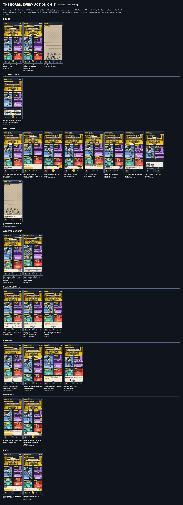
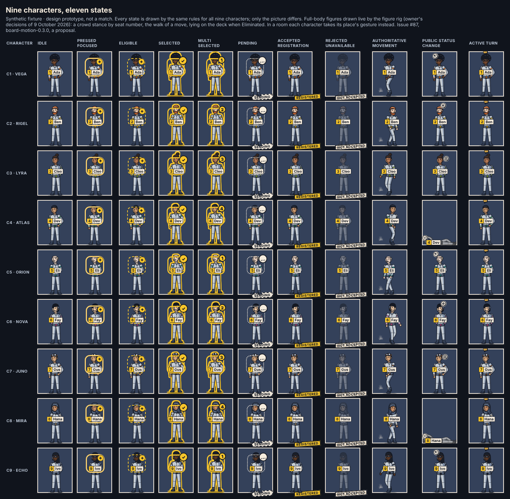

# Board motion: the board as the game

`mothership:dev-only` · issue [#87](https://github.com/Amirkianfar66/GameN/issues/87) · **approved board-targeting direction; proposed scenes, motion treatments and production figures**

A working prototype of a phone where the comic board is the game. Every action of the pinned release is chosen from a compact tray and played on the board: the players it names are picked by tapping their characters in their rooms, and the choice, its progress, its confirmation and the server's answer stay in a strip above navigation. Moving is pressing a room's name; Pass is the middle of navigation. The nine characters are full-body comic figures (the owner's "lets try full body comic", 9 October 2026), and each room is a scene with five fixed places, the Command Room one (the owner's decision of the same day): 21 places, each with its own gesture, like people in a comic panel: at the workstation, crouched at the hatch, at the microscope, a laptop on the knees, sitting up in a Hospital bed, in the wheelchair, at the Jail door, on the cot, the Captain leaning over the chart table. Every gesture has two animations: getting up, walking to another room and settling into the new place; and a hit (a burst and a jolt, then a flinch and a bandage when Injured, or the place's fall when Eliminated). Every character has the same eleven interaction states. Beside the phone, a second board draws what every other screen sees at the same moment, from public facts only.

Designed on `94a49ce0` (`codex/v1-pass-board-targets`, [PR #86](https://github.com/Amirkianfar66/GameN/pull/86), unmerged): protocol 2, engine `full-game-1.1.0`, ruleset `in-person-v1-pass-2026-10-08`. Drawn with tokens 0.4.0 and the three bundles of `design-0.2.0`, loaded whole by the reviewed loader, plus the proposed scenes and figures (below). Everything shown is a **labeled synthetic fixture**: it is not the game, not Firebase and not multiplayer acceptance, and nothing here talks to a server. The stand-in server answers as the fixture panel says.

The design, the handoff and the checks: [board-motion-handoff.md](../../docs/design/board-motion-handoff.md), [board-motion-coverage.md](../../docs/design/board-motion-coverage.md) (generated), [board-motion-verification.md](../../docs/design/board-motion-verification.md).



## Open it

```sh
npm run dev:review --workspace @mothership/design-tokens   # serves design/ on http://127.0.0.1:4320
```

| | |
| --- | --- |
| The phone, the other screens, and the prototype controls | `http://127.0.0.1:4320/board-motion/` |
| One scenario | `http://127.0.0.1:4320/board-motion/?scenario=crowd.vote` |
| A phone size | `&w=320&h=568` |
| Reduced motion, long names | `&motion=reduced`, `&names=long` |
| The card kept on an out-of-date view (DSN-REQ-16) | `?scenario=stale.card`; on any scenario, `&stale=card` |
| The phone alone, full screen (how the captures are made) | `&chrome=0`; simulated safe areas `&safe=1` |
| Hold every animation at a moment (how the storyboards are made) | `&play=move&t=450`; also `injure`, `eliminate`, `hospital` (Injured, then the move to the Hospital), `jail`, `release`, `captain` |
| The figure lab: gestures, scenes, animations | `http://127.0.0.1:4320/board-motion/lab/?g=think,microscope`, `?scene=room-b` (or `&panel=172x300`), `?strip=hitDown&g=leanBench&to=slumpBench` |
| Nine characters in eleven states | `http://127.0.0.1:4320/board-motion/vocabulary.html` |
| The contact sheets | `http://127.0.0.1:4320/board-motion/contact.html?set=key` (`all`, `matrix`, `motion`, `secrecy`) |

Crowded-room scenarios are marked **layout stress** on the phone and in the selector: six or more in one room is beyond the owner's capacity of five (a hard rule since 11 October 2026, not yet enforced by the engine), kept to show the board still draws such a view. A full room's tag says FULL (`move.full`). The offer guard checks static engine predicates, not resources or an engine-reachable match history.

The controls on the right are the prototype's own, not the design: pick a scenario, choose how the stand-in server answers the next command (accept, reject, lose the answer, slow), deliver public facts to every screen (a move, a health change, a new Captain, the next turn or round, the match's end, a replay of the last snapshot, a reconnect) and private facts to the seat alone (a Protection granted or used up), put the phone's own view out of date (the connection lost, an update that could not be read, the turn's time up, a fresh view), keep the card open on an out-of-date view (DSN-REQ-16), and switch reduced motion or long names. On the phone, everything works: Actions, every action, every character, room tags, Pass, Card, Menu, Escape.

## What is in it

| Path | What it is |
| --- | --- |
| `index.html`, `js/app.js` | The phone: the controller (the release's steps, one command at a time), drawing, the board's fit, the observer, the fixture panel and `?play=&t=` holds. It loads the phone kit (`design/phone-kit/`, issue #121: the navy and gold shell, the vote result, the private Hack); `?kit=0` leaves out the kit's stylesheet |
| `js/board.js` | The comic board from public facts: each room a framed scene, each character drawn live at its place; private cues passed in by the viewer's own action only |
| `js/layout.js` | Places and gestures from public facts: who is in the room by seat number and the places drawn before, the Captain, Injured, Eliminated. Pure: the checks run it in Node |
| `scenes/` | The five rooms as scenes: `kit.mjs` (the drawing of decks, props and light), one module a room (its approved groups, its props, its 21 places' points, scales, depths, gestures and falls, the layers drawn in front of a place), `compose.mjs` (lifts the approved groups and recolors them), `frame.mjs` (how a scene is framed in a panel of any size, and its press areas) |
| `figures/` | The figures' drawing rig: `rig.mjs` (ink, cel shadow, halftone, hatching), `crew.mjs` (the nine characters, in `color.crew`, front and back heads), `parts.mjs` (hands, boots, held things), `body.mjs` (a skeleton drawn as a body), `gestures.mjs` (27 gestures; the marks `+injured` and `+still`), `motion.mjs` (blending, the walk, the jolt, flinch and fall, and the timelines), `plan.mjs` (the review sheets), `wardrobe.mjs` (the room clothes, issue #121: the Hospital gown and the Jail suit by public location; the crew suit is `body.mjs`'s figure byte for byte) |
| `lab/` | The figure lab: gestures for all nine, a scene with its places taken, an animation as a row of frames |
| `js/director.js` | Public cues from the difference between two drawn views: moves (out of the place, the walk, into the new one, in the clothes of the room left and then of the room reached), hits, status changes, turn, phase, round, the match's end |
| `js/dress.js` | Dresses the board's figures in their room's clothes after each update (`board.js` is a frozen drawing source and is not changed) |
| `js/copy.js` | The release's words (`COPY`, compared with the built `en`; `SHELL`, found verbatim), and the new words (`PROPOSED`) |
| `js/fixtures.js` | 163 synthetic scenarios, the nine characters, and the public and private facts the panel delivers |
| `js/vocabulary.js`, `vocabulary.html` | Nine characters in eleven states, drawn by the rig as the board draws them |
| `css/board.css` | Tokens only, art only behind the bundle marks, private cues only on the own board, roles only inside the card and, at a finished match, the end's result sheet; nothing repeats |
| `contract/cues.json` | Every cue: trigger, audience, facts, anchor, timing, cancellation, settled state, reduced motion, asset |
| `contract/coverage.json` | Every action and command; the eleven states; every fact and its source; the components and the release hooks; the gaps |
| `assets/` | The scene layers (`scenes/`, nine files) and their one stylesheet; the manifest `board-motion-0.3.0` with every scene layer, place and figure sheet. Written by `design/tools/board-motion-assets.mjs` |
| `contact.html` | Lays out the captures as contact sheets |
| `review/` | Written by `design/tools/board-motion-capture.mjs`: `states/` (every scenario at 390 x 844), `matrix/`, `motion/` (storyboard frames), `secrecy/` (the phone beside the other screens), `vocabulary.png`, five contact sheets, `index.json`, `report.json` |

## The scenes

Each room's walls, viewport, fittings and props are lifted, element for element, from the approved room source in `design/source/board/` and printed in the room's colors by its reviewed export recipe; around them `scenes/` draws a new deck, the props of the room's five places (a workstation, crates and a floor hatch; a specimen tank and a stool; a wheelchair, an IV stand and a bench; a cot) and its light. What stands in front of a place (the chart table, the laboratory bench, the two beds) is a layer of its own, so a character can be behind it. A versioned proposal (`board-motion-0.3.0`), outside the reviewed manifest `design-0.2.0`, which is unchanged; adopting it is Integration's (DSN-D30) and the look the owner's (DSN-D34). Rights as for the rest of the artwork: original, no license granted, use inside the Mothership project only (DSN-D06). It is vector drawing made here, not painted art: a composition an illustrator can repaint, place by place.

## The figures



The nine approved characters drawn full body, live, by one rig (`figures/`) from a skeleton for each gesture: the 21 places' gestures, three standing stances for a crowd or the Final Zone, and three falls (on the deck, over the desk, over the bench; or `+still` where a character sits or lies). A move and a hit are generated from whatever gesture the character holds. Their skin, field and accent are `color.crew` of tokens 0.4.0 and their hair `color.crewHair` or a public tone, as on the approved standees; the shading is the palette's next darker tone or an ink tint, with halftone and hatching inside the shadow. What lies over a prop (the hands on the desk, the arms on the blanket) is a second layer. A bandage, and H5's sling, only on a character the public view says is Injured. No figure picture is fetched; the review sheets of every gesture are written on request. A versioned proposal (DSN-D32); the approved standees in `design/source/crew/` and the runtime are unchanged. Whether a gesture may say what a marker says is DSN-D33.

```sh
npm run assets:board-motion --workspace @mothership/design-tokens           # write the scene layers and the manifest
node design/tools/board-motion-assets.mjs --check                          # compare
node design/tools/board-motion-assets.mjs --sheets /tmp/sheets             # write every gesture's sheet of the nine, for review
```

## Checks

```sh
npm run check:board-motion --workspace @mothership/design-tokens     # no browser; needs npm run build
npm run capture:board-motion --workspace @mothership/design-tokens   # screenshots and measurements; needs a browser
npm run flows:board-motion --workspace @mothership/design-tokens     # presses the controls; needs a browser
npm run test --workspace @mothership/design-tokens                   # includes the tests that make the check fail on purpose
```
