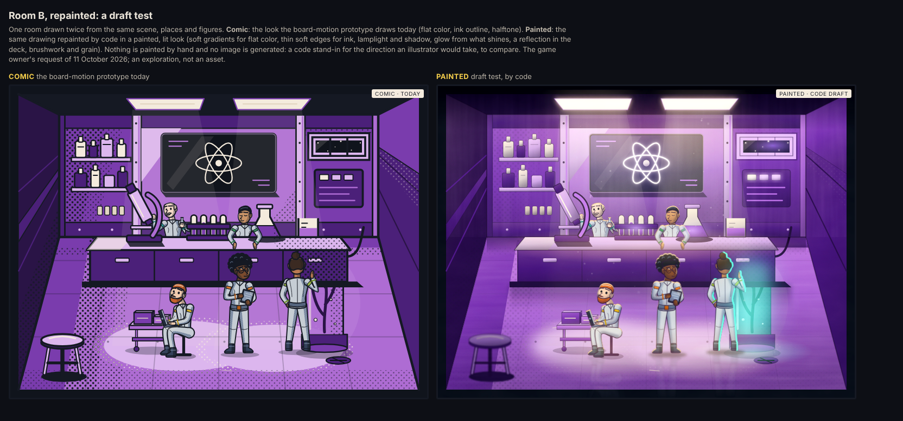
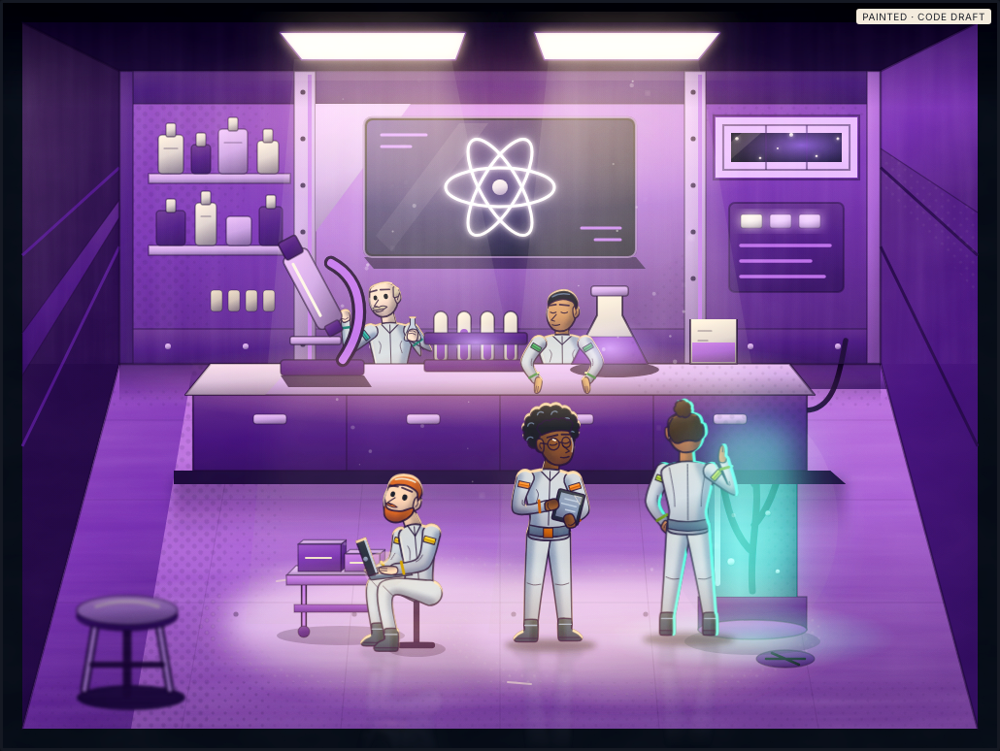
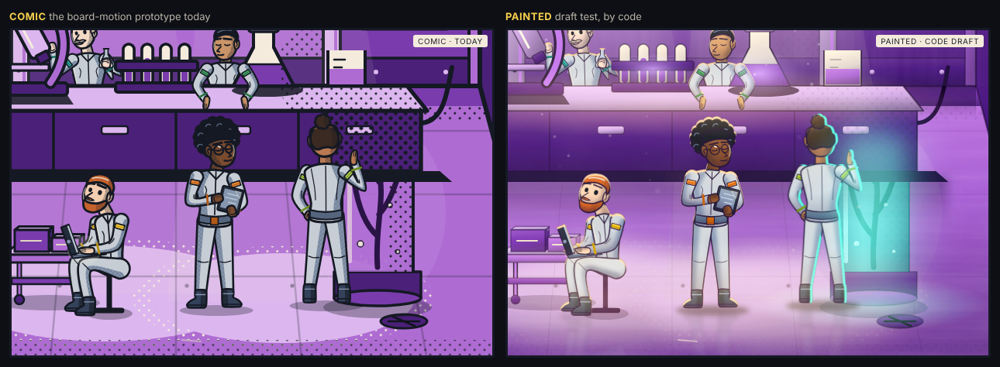
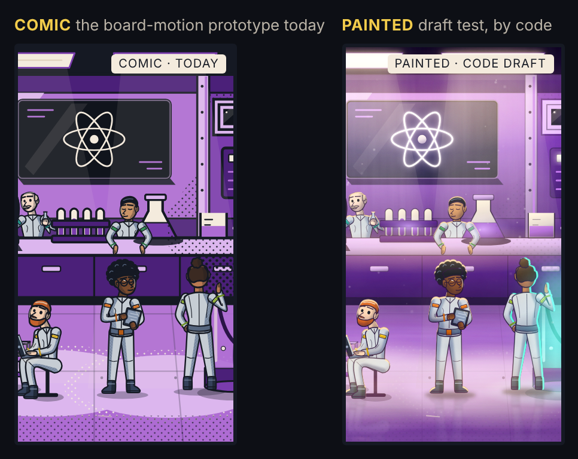

# Painted room test

`mothership:dev-only`

**A draft test for the game owner's request of 11 October 2026:** *"lets repaint just 1 art work as a draft test to compare. it can be just 1 room test"*. It follows the owner's wish of 9 October 2026 that each room be *"like AAA game or animation art work … like a scene"* ([owner-decisions.md](../../../docs/design/owner-decisions.md#9-october-2026-five-places-a-room-each-a-scene)), and it is evidence for DSN-D34: is the procedural vector look enough, or should the scenes be repainted?

**The owner's answer, the same day:** *"dont go with mix lets try whiteout paint the current  in game then i will judge"*: no mix and no paint for now. The current, unpainted look is to be tried in the game first, and the owner will judge it there ([owner-decisions.md](../../../docs/design/owner-decisions.md#11-october-2026-the-current-look-in-the-game-before-any-paint)). This page is kept as evidence and is not developed further.

One room, Room B (the laboratory), drawn twice from the same scene, the same five places and the same figures:

- **Comic**: the room as the board-motion prototype draws it today: flat color, ink outline, halftone.
- **Painted**: the same drawing repainted by code in a painted, lit look.

**What this is not.** Nothing here is painted by hand, and no image is generated or fetched. The painted look is the comic drawing put through code in the browser: gradients, blend modes and SVG filters. It stands in for the direction an illustrator would take, so that the two looks can be compared side by side. An illustrator's repaint would go further: painted texture and materials, light written into each shape, figures repainted rather than filtered. This is an exploration. It is not an asset, a token, a contract, a shell or the game, and nothing reviewed reads it.

## What the repaint changes

| | Comic (today) | Painted (this draft) |
| --- | --- | --- |
| Color | Flat fills | Each flat color becomes a gradient: lamplight above, the room's violet below. Shadows go to a deep violet, never black |
| Ink | A heavy outline on every shape | A thin, soft edge in the room's dark: about 40% of the width on the room and 60% on the figures. Heavy ink lines that are things (the microscope's cable, the legs of the stools and the cart) stay. The room's ink fills (ceiling, kick plate, shadows) take the room's violet |
| Shading | Halftone dots and hatching | Kept at 12% as texture; a slow mottling of value, long brush strokes across the deck and upright ones on the walls, a fine grain |
| Light | Printed light cones and pools | The two ceiling lamps shine with a bloom; soft beams with dust in them; warm pools on the deck, the bench and the wall; corners and ceiling fall into the room's violet |
| What shines | Drawn flat | The diagram screen glows behind glass; a nebula in the slit window; the console lights, the flask and the tubes glow; the specimen tank is lit teal, the room's one cool accent, and spills onto the deck |
| Figures | A cel shadow with a hard edge | The cel shadow softened into the form; a rim light from the lamps (teal on B3, standing at the tank); shade under the form; a soft contact shadow; a faint reflection in the deck |
| Depth | None | A haze on the far wall; a shadow under the bench and along the foot of the wall; the stool nearest us goes soft and dark |

The places, the gestures, the figures' drawing and the room's composition are the same in both: only the rendering changes.

## Closer, and on a phone

| The three places on the deck and the tank | Room B in a phone panel's framing (180 × 330 CSS px, at 2×) |
| --- | --- |
|  |  |

What these desktop renders show, without measuring anything: in the phone framing, the painted room's glowing screen, the teal tank and B3's rim light draw the eye. Its figures are softer than the comic's, though, and the seated B2 is pale against the lit deck, while the comic's ink still separates every figure crisply at that size. A repaint for the board would need to keep figures standing out from the deck at phone sizes. No device, no assistive technology and no frame-rate measurement was used.

## Why it is a page and not an asset

The drawing vocabulary of the design sources (`design/tools/lib/svg.mjs`) allows only shapes in flat color: `svg`, `defs`, `g`, `path`, `circle`, `ellipse`, `rect`, `polygon`, `pattern` and `clipPath`. It has no gradients, filters, blend modes or masks, and the exploration fence (`npm run check:assets`) holds explorations' drawings to that vocabulary too. So the painted look is not stored as a drawing. This page draws it live and keeps it only as review pictures. If the owner prefers the painted direction, adopting it would need one of these:

1. **Widening the vocabulary for scene art** (gradients, filters, blend modes): Integration's change to the shared drawing rules, with a budget for phones. Blurs, lighting filters and blend modes cost drawing time on every frame the board animates, and nothing here measures that.
2. **Painted raster art by an illustrator**, with its rights and source files recorded (DSN-D06), painted to the scenes' places, depths and layers so that the figures still stand in them and the move and hit animations still work.

Either way the choice of look is the owner's (DSN-D34), and adoption is Integration's and Frontend's.

## Open it

`npm run dev:review --workspace @mothership/design-tokens`, then `http://127.0.0.1:4320/explorations/painted-room/`.

| Parameter | What it does |
| --- | --- |
| `?view=compare` (default), `comic`, `painted` | Both looks side by side, or one |
| `?panel=180x330` | A phone panel's framing of the room, as the board frames it (`design/board-motion/scenes/frame.mjs`) |
| `?crop=x,y,w,h` | A detail of the room, in its 1024 × 768 units |
| `?scale=0.75` | The size of each picture on the page |

## What it is

| File | What it holds |
| --- | --- |
| `index.html`, `painted.css` | The page and its layout |
| `painted.js` | Composes Room B as the board does, from the board-motion scene layers (`design/board-motion/assets/scenes/room-b.back.svg`, `room-b.bench.svg`) and the figure rig (`design/board-motion/figures/`). Every place is taken, and everything is drawn in depth order, with the bench drawn again over B4 and B5. Then the repaint, live in the page. The five figures are the first five of the nine approved characters, synthetic, in Room B's five gestures: B1 reading a tablet, B2 a laptop on a stool, B3 at the specimen tank, B4 leaning on the bench, B5 at the microscope |
| `render.mjs` | Writes the review pictures in `review/` (run by hand: `node design/explorations/painted-room/render.mjs`) |
| `review/` | `room-b-compare.png`, `room-b-painted.png`, `room-b-detail.png`, `room-b-phone-panels.png`: desktop Chromium, written by `render.mjs` |

Nothing in it is a match, a role, a team or a player's secret. Rule-version impact: none.
