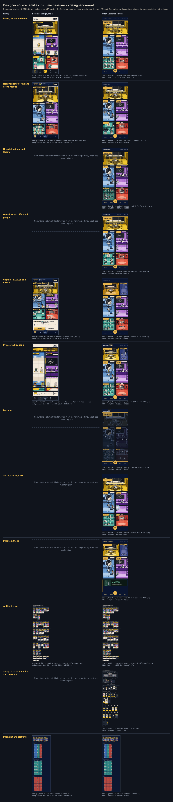

# Designer work inventory and gap map

Generated by `node design/tools/cinematic-docs.mjs` from `design/cinematic/inventory/inventory.json` (written by `node design/tools/cinematic-inventory.mjs`, which reads git objects only and changes no checkout) and `design/cinematic/inventory/contact-before-after.json` (written by `node design/tools/cinematic-contact.mjs`).

Scope: `design`, `docs/design`, `packages/design-tokens`, across the runtime baseline, the design baseline and every Designer pull-request head. A file's *current* version is the newest Designer version by the chain precedence board-v2 > abilities > board-motion > phone-first > art-direction; its PR is the earliest Designer PR (by head time) holding that exact version.

## Heads read

| Head | Commit | What |
| --- | --- | --- |
| main | `db65bb87f059` | Runtime baseline: origin/main (#171, the reviewed V1 release) |
| design-baseline | `26947b1fbf00` | Design baseline: codex/design-studio-development (Engineer and Doctor names) |
| #45 | `6017c61ac4a2` | Define cue freshness, and keep public cues independent of private updates |
| #57 | `4fa2ff3db5ed` | Record the owner's approval of the comic-board direction, and what adopting it takes |
| #59 | `ecbc0d703fa5` | Adopt the owner-approved comic board: sources, tokens 0.4.0, exports, contract and reference states |
| #78 | `87ac25440f9f` | Design the phone-first V1 journey (#76) |
| #77 | `a9bc4a95df75` | docs(frontend): review staged start and hand phone-first states to Designer |
| #88 | `08409392d104` | Keep the board's figures under the card, tray, strip and menu |
| #102 | `1453500a2c23` | Stretch the stamp frame to its word |
| #105 | `022ae5be841b` | Record npm run verify on the slice 2 commit |
| #107 | `3ec88ea893e2` | Hold only the slip's beat in its review frames |
| #108 | `1a52f567ba29` | Record npm run verify on the slice 4 commit, and cite the right rule |
| #109 | `a3379d1179b6` | Record npm run verify on the slice 5 commit |
| #110 | `1e2f4916ea34` | Record npm run verify on the slice 6 commit |
| #111 | `8f1f356f2208` | Record npm run verify on the slice 7 fix |
| #116 | `27be8749b517` | Bring the kit's version and slice summaries up to slice 8 |
| #127 | `5c9a1510d35d` | docs(design): hand off the Hack review correction to Frontend (#121) |
| #128 | `a864f1f2d054` | fix(design): lowest-free slots and a shell that fits above 600 px (review findings 3 and 4) |
| #129 | `e1d4e7480365` | docs(design): board v2's handoff to Frontend after the Integration review |
| #130 | `15e61f0bbd04` | docs(design): board v2's Frontend handoff at ebf0263, with exact hashes |
| #144 | `95d70f0c885f` | Deliverables index v2; the owner's specification packet preserved |
| #158 | `7cf140aff603` | Deliverables index version 3: say what the commits after #158's listed head add |
| #159 | `7f3344ede87e` | Deliverables index version 4: the Captain films, their path list and the four-bed decision |
| #160 | `90dcd58aa839` | Deliverables index version 7: #160's fix and its path list |
| #161 | `98ccb984ee62` | Deliverables index version 9: the live release and the successor candidate |
| #93 | `74ce6ee38675` | docs(design): record clean phone follow-up verification |
| #113 | `859580c80514` | docs(design): clarify combined release verification ownership |
| #117 | `428c1c741c5c` | fix(design): admit reviewed drawing ports with strict prototype fence |
| #124 | `44c25268a04d` | feat(design): propose phone kit and public-room wardrobe sources |

## Summary

| Measure | Files |
| --- | --- |
| paths | 2692 |
| designerCurrent | 2144 |
| absentFromMain | 824 |
| identicalOnMain | 1486 |
| mainNewer | 10 |
| mainOlder | 3 |
| notDesigner | 369 |
| runtimeRegistered | 209 |
| runtimeOlderThanDesigner | 0 |
| withObsoleteNames | 92 |

Nothing on `main` is older than the Designer's version in any runtime registry (`runtimeOlderThanDesigner` 0): the runtime holds the newest reviewed Designer art for everything it registers. 824 Designer files are absent from `main` (unmerged PR work, mostly the board-v2 stack #128 to #161 and the review captures); none of them is reset or overwritten by this delivery.

## Families

| Family | Files | MB | Same on main | Absent from main | Main newer | Main older | Runtime registered (current) | Obsolete names | PRs |
| --- | --- | --- | --- | --- | --- | --- | --- | --- | --- |
| Ability dossier | 367 | 71.0 | 319 | 45 | 2 | 0 | 4 (3) | 22 | #102 #105 #107 #108 #109 #110 #111 #116 #127 |
| ATTACK BLOCKED | 32 | 12.6 | 4 | 28 | 0 | 0 | 2 (2) | 1 | #45 #59 #130 #144 #160 |
| Blackout | 65 | 20.8 | 16 | 49 | 0 | 0 | 16 (16) | 0 | #129 #130 #144 #160 |
| Board motion: rooms, slots and director | 520 | 76.2 | 379 | 141 | 0 | 0 | 12 (12) | 11 | #88 #107 #111 #127 |
| Board v2 review page and tools | 137 | 49.8 | 8 | 120 | 0 | 0 | 13 (8) | 2 | #128 #129 #130 #144 #160 #161 |
| Board v2 slots and phone layout | 6 | 0.1 | 3 | 3 | 0 | 0 | 3 (3) | 0 | #128 #144 #160 |
| Captain RELEASE / EJECT | 172 | 35.1 | 17 | 108 | 0 | 0 | 46 (46) | 1 | #45 #127 #159 #160 |
| Character rig and crew | 10 | 0.1 | 8 | 2 | 0 | 0 | 7 (7) | 1 | #88 #127 |
| Comic board exports and sources | 214 | 13.2 | 200 | 14 | 0 | 0 | 0 (0) | 8 | #45 #59 |
| Design documentation | 51 | 2.0 | 29 | 18 | 1 | 2 | 0 (0) | 19 | #45 #59 #88 #111 #127 #128 #129 #144 #158 #160 #161 |
| Design tokens and tests | 15 | 0.2 | 9 | 1 | 3 | 1 | 0 (0) | 3 | #45 #59 #127 #128 #144 |
| Design tools | 31 | 0.5 | 24 | 0 | 4 | 0 | 0 (0) | 5 | #45 #59 #88 #111 #127 |
| Explorations and studies | 105 | 11.9 | 78 | 27 | 0 | 0 | 0 (0) | 6 | #45 #57 #59 #88 |
| Hospital medical films | 136 | 27.3 | 16 | 90 | 0 | 0 | 46 (46) | 1 | #128 #129 #158 #160 |
| Hospital: four-berth ward and overflow | 45 | 4.7 | 0 | 29 | 0 | 0 | 15 (15) | 1 | #160 |
| Integration release registries | 157 | 2.4 | 0 | 0 | 0 | 0 | 3 (0) | 0 |  |
| Patient and prisoner clothing | 4 | 0.0 | 2 | 0 | 0 | 0 | 1 (0) | 0 | #127 |
| Phantom Clone | 84 | 15.0 | 0 | 61 | 0 | 0 | 23 (23) | 1 | #161 |
| Phone feedback (Codex adaptation) | 76 | 1.1 | 0 | 0 | 0 | 0 | 3 (0) | 0 |  |
| Phone kit | 151 | 29.5 | 149 | 1 | 0 | 0 | 2 (2) | 1 | #127 #144 |
| Private Talk capsule | 59 | 24.0 | 11 | 48 | 0 | 0 | 11 (11) | 1 | #144 #159 #160 |
| Setup art: character choice and role card | 2 | 0.0 | 0 | 0 | 0 | 0 | 2 (0) | 0 |  |
| V1 phone journey | 253 | 20.9 | 214 | 39 | 0 | 0 | 0 (0) | 8 | #78 #127 |

## The brief's named source families: current versions

| Source | Path | SHA-256 (12) | Bytes | First PR with this version | On main | Runtime use |
| --- | --- | --- | --- | --- | --- | --- |
| Figure body and rig | `design/board-motion/figures/body.mjs` | `9d081fc4926d` | 11194 | #88 | identical | `apps/game/hosted/scene-drawing/body.mjs` |
| Rig | `design/board-motion/figures/rig.mjs` | `b7fd681bb392` | 8506 | #88 | identical | `apps/game/hosted/scene-drawing/rig.mjs` |
| Crew | `design/board-motion/figures/crew.mjs` | `bb65a81f5201` | 12703 | #88 | identical | `apps/game/hosted/scene-drawing/crew.mjs` |
| Gestures | `design/board-motion/figures/gestures.mjs` | `626e0b74fba4` | 19192 | #88 | identical | `apps/game/hosted/scene-drawing/gestures.mjs` |
| Motion (blend, walk) | `design/board-motion/figures/motion.mjs` | `b50a12ff2e96` | 11392 | #88 | identical | `apps/game/hosted/scene-drawing/motion.mjs` |
| Patient and prisoner clothing | `design/board-motion/figures/wardrobe.mjs` | `1c30862d77ce` | 22959 | #127 | identical | `apps/game/hosted/scene-drawing/wardrobe.mjs` |
| Scene framing | `design/board-motion/scenes/frame.mjs` | `aa2a9531f8ba` | 3378 | #88 | identical | `apps/game/hosted/scene-drawing/frame.mjs` |
| Slots (roster ward) | `design/board-v2/scenes/slots.mjs` | `cf329360c86b` | 6747 | #128 | identical | `apps/game/hosted/board-v2-drawing/slots.mjs` |
| Slots (four beds) | `design/board-v2/scenes/slots-four.mjs` | `268d53c7a807` | 5549 | #160 | absent from main | `apps/game/hosted/board-v2-drawing/slots-four.mjs` |
| Hospital ward (roster) | `design/board-v2/scenes/hospital-ward.mjs` | `d6af092a8632` | 15510 | #128 | identical | `apps/game/hosted/board-v2-drawing/hospital-ward.mjs` |
| Hospital ward (four beds) | `design/board-v2/scenes/hospital-ward-four.mjs` | `005311acdcef` | 11836 | #160 | absent from main | `apps/game/hosted/board-v2-drawing/hospital-ward-four.mjs` |
| Capsule scene | `design/board-v2/scenes/capsule.mjs` | `51150af446d8` | 22280 | #144 | identical | `apps/game/hosted/board-v2-drawing/capsule-scene.mjs` |
| Capsule figures | `design/board-v2/figures/capsule.mjs` | `a90ae47382d5` | 7455 | #144 | identical | `apps/game/hosted/board-v2-drawing/capsule-figures.mjs` |
| Capsule film (S2) | `design/board-v2/films/capsule.mjs` | `889b2dc4b30d` | 22989 | #144 | identical | `apps/game/hosted/board-v2-drawing/capsule-film.mjs` |
| Lighting (Blackout) | `design/board-v2/scenes/lighting.mjs` | `ed8ce0def1b0` | 13393 | #129 | identical | `apps/game/hosted/board-v2-drawing/lighting.mjs` |
| Blackout film | `design/board-v2/films/blackout.mjs` | `361c57acf83e` | 13919 | #130 | identical | `apps/game/hosted/board-v2-drawing/blackout-film.mjs` |
| Blocked impact (S4) | `design/board-v2/fx/blocked.mjs` | `6408b5229172` | 8924 | #130 | identical | `apps/game/hosted/board-v2-drawing/blocked-fx.mjs` |
| Medical art | `design/board-v2/fx/medical.mjs` | `3f596f1537d0` | 28332 | #158 | absent from main | `apps/game/hosted/board-v2-drawing/medical-fx.mjs` |
| Medical (four beds) | `design/board-v2/fx/medical-four.mjs` | `90ae67a8cd9c` | 7839 | #160 | absent from main | `apps/game/hosted/board-v2-drawing/medical-four.mjs` |
| Medical films (S5, S9, S10) | `design/board-v2/films/medical.mjs` | `fef1b67902b1` | 28292 | #158 | absent from main | `apps/game/hosted/board-v2-drawing/medical-film.mjs` |
| Captain art | `design/board-v2/fx/captain.mjs` | `ad2853bf1e91` | 43752 | #159 | absent from main | `apps/game/hosted/board-v2-drawing/captain-fx.mjs` |
| Captain films (S6, S7) | `design/board-v2/films/captain.mjs` | `70f871155418` | 34708 | #159 | absent from main | `apps/game/hosted/board-v2-drawing/captain-film.mjs` |
| Clone art | `design/board-v2/fx/clone.mjs` | `c565f4301350` | 12576 | #161 | absent from main | `apps/game/hosted/board-v2-drawing/clone-fx.mjs` |
| Clone film (S3) | `design/board-v2/films/clone.mjs` | `34836d024ad9` | 14005 | #161 | absent from main | `apps/game/hosted/board-v2-drawing/clone-film.mjs` |
| Overflow | `design/board-v2/films/overflow.mjs` | `074df18a98ba` | 8918 | #160 | absent from main | `apps/game/hosted/board-v2-drawing/overflow-film.mjs` |
| Board fit (four beds) | `design/board-v2/js/fit-four.mjs` | `9091cee28f62` | 4043 | #160 | absent from main | `apps/game/hosted/board-v2-drawing/fit-four.mjs` |
| Turns (four beds) | `design/board-v2/js/turns-four.mjs` | `a1099fee5c44` | 8413 | #160 | absent from main | `apps/game/hosted/board-v2-drawing/turns-four.mjs` |

Every named family is present; no source the brief names is missing.

## Files where main and the Designer differ

Ten files on `main` are newer than the Designer's last version: Integration (Codex) changed them after the Designer (drawing-port fences and checks for the reviewed ports). The Designer keeps them as `main` has them; this delivery does not touch them. Three files on `main` are older (the Designer's README, owner-decisions and the design-tokens manifest moved on in unmerged PRs).

| Path | State |
| --- | --- |
| `design/tools/abilities-check.mjs` | main holds a newer version (changed after the Designer) |
| `design/tools/board-motion-check.mjs` | main holds a newer version (changed after the Designer) |
| `design/tools/board-motion-docs.mjs` | main holds a newer version (changed after the Designer) |
| `design/tools/lib/drawing-port-fence.mjs` | main holds a newer version (changed after the Designer) |
| `design/tools/lib/reviewed-drawing-ports.json` | main holds a newer version (changed after the Designer) |
| `docs/design/board-motion-coverage.md` | main holds a newer version (changed after the Designer) |
| `docs/design/owner-decisions.md` | main holds an older version |
| `docs/design/README.md` | main holds an older version |
| `packages/design-tokens/package.json` | main holds an older version |
| `packages/design-tokens/test/abilities-check.test.mjs` | main holds a newer version (changed after the Designer) |
| `packages/design-tokens/test/board-motion-check.test.mjs` | main holds a newer version (changed after the Designer) |
| `packages/design-tokens/test/drawing-port-fence.test.mjs` | main holds a newer version (changed after the Designer) |
| `packages/design-tokens/test/fixtures/reviewed-comic-assets.txt` | main holds a newer version (changed after the Designer) |

## Names to correct

92 files still carry a superseded name: Cracker (now Doctor), Soldier Blue (now Engineer), Showdown and Final Zone (removed mechanics). They are historical art and review captures; current text uses the new names (design baseline 26947b1). Corrections ride the next asset group that touches each file, never a silent substitution. Library group 8 maps every current name to the art that draws it (`design/library/successor/names.mjs`): the files keep their historical ids and bytes.

## Before / after contact sheet

| Family | Before (main) | After (Designer current) |
| --- | --- | --- |
| Board, rooms and crew | `docs/frontend/evidence/board-play/simulation/390x844-board.png` `1c6236387a3e` | `design/board-v2/review/board-390x844-ward.png` (#161 stack) `6f0c401d46e3` |
| Hospital: four berths and drone rescue | `design/board-motion/review/states/board.crowded-hospital.png` `c1709a236ebb` | `design/board-v2/review/four-390x844-rescue-2600.png` (#160) `e67823fc61e0` |
| Hospital: critical and flatline | none on main | `design/board-v2/review/medical-390x844-flatline-2000.png` (#158) `dec00fe32096` |
| Overflow and off-board plaque | none on main | `design/board-v2/review/four-390x844-overflow-0700.png` (#160) `7a664ad3cc66` |
| Captain RELEASE and EJECT | `design/board-motion/review/states/release.vote-yes.png` `3c251cdacc31` | `design/board-v2/review/captain-390x844-eject-3500.png` (#159) `18849b942695` |
| Private Talk capsule | `docs/frontend/evidence/board-play/emulator/emulator-06-hack-choose.png` `ddad3cc921d2` | `design/board-v2/review/capsule-390x844-result-2400.png` (#144) `de2e36e1bd83` |
| Blackout | none on main | `design/board-v2/review/blackout-390x844-8000-dark.png` (#129) `df225b6f447b` |
| ATTACK BLOCKED | none on main | `design/board-v2/review/blocked-390x844-0280-bubble.png` (#130) `f7deb036cbe9` |
| Phantom Clone | none on main | `design/board-v2/review/clone-390x844-activate-1900.png` (#161) `24270aa70960` |
| Ability dossier | `design/abilities/review/contact-rescue-disable-supply.png` `934beefa248d` | `design/abilities/review/contact-rescue-disable-supply.png` (#116 chain) `6c90e6dea179` |
| Setup: character choice and role card | none on main | `design/abilities/review/contact-setup.png` (#116) `577f1322f79b` |
| Phone kit and clothing | `design/phone-kit/review/contact-clothes.png` `8528b670b449` | `design/phone-kit/review/contact-clothes.png` (#127) `8528b670b449` |

## Gap map

What the catalogue (docs/design/cinematic/motion-bible.md) still needs, by scene:

| Scene | Status | Missing |
| --- | --- | --- |
| Role reveal and private card | existing (slice 8) + library group 8 (current names, the Engineer's device) + the role films (the owner, 6 November 2026, with the briefing-room opener, the noir relighting, the comic back story and the animated-comic finish from the owner's reviews of the pilot): the Doctor's pilot, the other eight storyboarded | The role films of the other eight roles are storyboards until the owner reviews the Doctor's pilot on a phone. |
| Core board and movement | existing (board-motion walk, board-v2 slots) | origin slot for walks after reconnect (request R4) |
| Doctor Rescue | PILOT 1 (cinematic pass over the approved S5): the board treatment on phones and the display; the display cut only where nobody decides | live-action insert: study only (NOT PRODUCED) |
| Hack Spaceship | library group 1 (proposal) | no public or office cue for the hack beyond the direction itself: none is authorized |
| Private Talk capsule | PILOT 3 (the display's entrance page over the approved S2, in the result stage; the talk and the exit are S2 on the board everywhere) | live-action study not needed (comic-only by design) |
| Blackhole and Sync | PILOT 2: the display's stage cut in P27's six-second presentation stage; phones behind the crew from the stage's start; behind the crew at the Jail vote's start wherever the stage's phase kind is missing (R16) | live-action insert: study only (NOT PRODUCED) |

