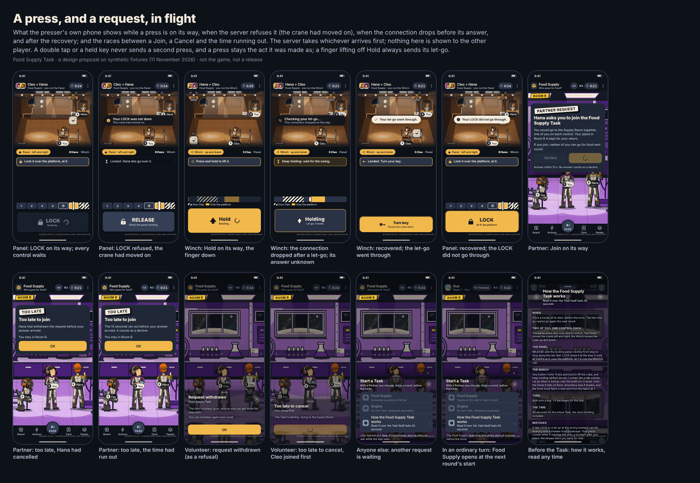
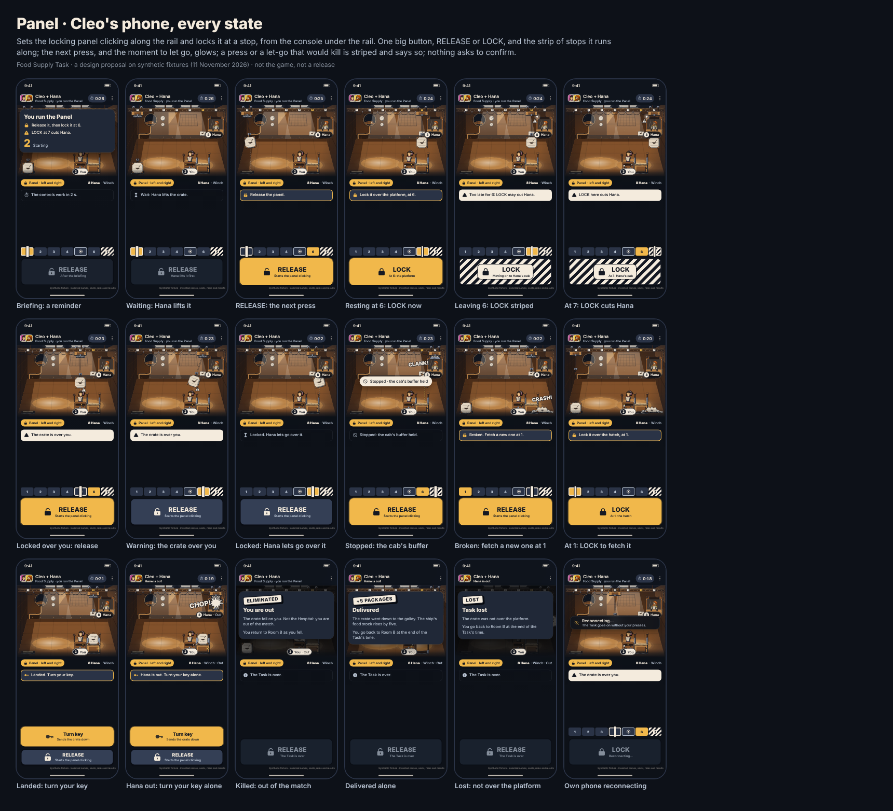
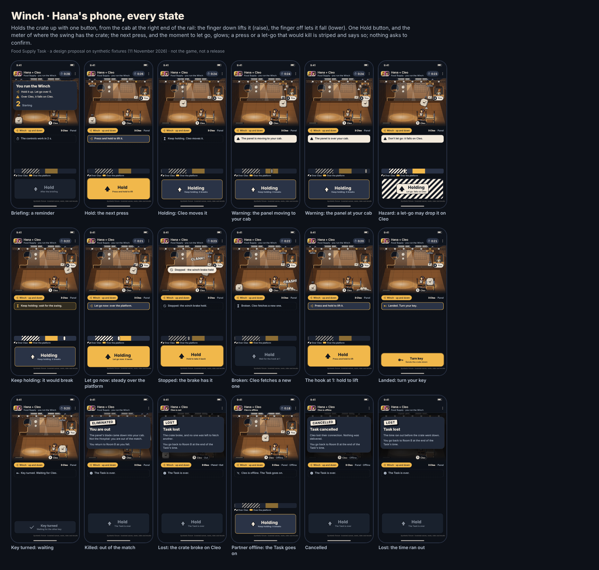

# The Food Supply Task

A two-player Task in the Supply Room, designed from the owner's confirmed highlights of 11 November 2026, the owner's answers the same day and on 12 November, and the owner's crane, which replaced the first design that evening ([owner-decisions.md](owner-decisions.md#11-november-2026-the-food-supply-task)). Integration and Frontend reviewed it on 12 November ([#231](https://github.com/Amirkianfar66/GameN/pull/231)); this version answers that review, and records the owner's rules for [playing the Task](#playing-the-task), decided on Designer's recommendation the same day. After playing the practice, the owner changed two things on 13 November 2026: the Winch is now **one Hold button**, and the locking panel moves **twice as fast** ([Hold and let go](#hold-and-let-go)). **A design proposal on synthetic fixtures. It activates no gameplay and is in no release.** Every choice of the design's own is marked PROPOSED; the rest follows the owner's decisions.

| | |
| --- | --- |
| Base commit | `8cbe5e896e2fa84f8d7c9df8da0b21cc9d55359d` (`main`, after PR #225), in its own worktree on `claude/designer-food-supply` |
| Ruleset in force there | `in-person-planet-blackout-before-vote-2026-11-10` (engine `planet-game-1.3.0`, protocol 3): `rules/planet-successor-blackout-before-vote-authority-2026-11-10.json` and `rules/overlays/planet-blackout-before-vote-owner-decision-2026-11-10.json`, over the successor authority `in-person-planet-2026-11-05` |
| Rule source for this Task | The owner's decisions of 11, 12 and 13 November 2026 only. No Task, Food or Supply Room rule exists under `rules/` at the base commit |
| The owner's detailed handoff | `docs/design/food-supply-requirements-2026-11-11.md` and `food-supply-concepts/` are on the owner's computer and were not available to this session. This design follows the owner's decisions; it will be reconciled with that file when it is shared |
| Fixtures | The phone pack's invented roster: Hana (seat 8) runs the Winch, Cleo (seat 3) the Panel, both from Room B. In the flow, Ava (seat 1) and Gus (seat 7) went for food last round, and the stock is 1 package before the Task |
| Runner | A Claude Code session acting as Visual and Motion Designer |

## The concept

**A crane on a ceiling rail, seen from the side, that two people must time together and either can turn on the other.** The Supply Room is a cargo bay with a rail across the top and seven stops painted on it, 1 to 7:

- **Stop 1:** the intake hatch, where the ration crate rises from the supply pod under the hull.
- **Stop 5:** the console, where **Cleo runs the Panel** (horizontal), standing under the rail.
- **Stop 6:** the galley lift's landing platform, where the crate should land.
- **Stop 7:** **Hana's cab**, hung under the rail's right end, right of the platform. Hana runs the **Winch** (vertical) from it.

The **locking panel** rides the rail with the crate's hoist on it. Delivering takes a hold, two presses, a let-go and two keys:

1. **Hana: Hold.** Hana presses and holds the Winch's one button: the crate rises out of the intake, and stays up only while Hana holds.
2. **Cleo: RELEASE.** The panel's blade lifts and the panel **clicks** along the rail, end to end and back: a fast snap to the next stop, then a short rest there (the owner's click, twice as fast since 13 November 2026: a 0.05 s snap and a 0.2 s rest, four stops a second).
3. **Cleo: LOCK** while it rests at stop 6. The blade drops and the panel stops there. The blade's slam **sets the crate swinging** like a pendulum, wide at first, then calmer, but never still.
4. **Hana: let go** as the swing passes over the platform. The crate lands, and the platform's jaws close. Let go anywhere else and the crate **breaks**: a new one rises into the intake, and the hook must go back for it.
5. **Both turn a key.** The lift takes the crate down to the galley: **+5 packages**.

**The challenge is timing and trust.** The same presses that deliver can kill:

- **The cut.** Stop 7 is Hana's cab. LOCK while the panel rests at it or snaps to it, and the blade drops into the cab.
- **The drop.** Locked over the platform, the swing carries the crate out over Cleo at the console. Let go while it is there, and it falls on Cleo, and breaks.

Both are ordinary moves at a dangerous moment, and both can happen by mistake: a LOCK made late in the rest at 6 lands as the panel snaps on to 7, and the swing is wide. While a danger lasts, both phones show it: the cab's lamp or the console's lamp flashes, and the mover's own button is striped and says what it would do. Nothing asks to confirm; the press, or the let-go, acts.

### Why it changed

The first design that day was a gantry on a grid of steps, with dice accidents near the operators. Having played a timing sketch of this crane, the owner chose it: the Winch's cab right of the platform, "a mechanism of locking system panel, which fast moving to right and left", which "by mistake … cut Hano", and a crate that "has a swinging or pendulum movement", so that not killing the partner "needs attention". The owner said yes to rebuilding the whole Task with it. The dice are gone: mistakes now come from the timing itself.

### Hold and let go

The owner played the practice ([Play it](#play-it)) and changed two things (13 November 2026):

- **The Winch is one button: Hold.** "There is 1 button user keeps pressing it to package be up and not press it package release down; if user release it in wrong position the package will break and user should pick an other package." The finger down on Hold lifts the crate out of the intake (with the hook over it) and keeps it up while the panel carries it and it swings; the finger off lets it fall. Over the platform, with the panel locked, it lands. Over the console it falls on the Panel operator: the drop, and the crate breaks. Anywhere else it breaks, CRASH!, and a new crate rises into the intake: Cleo brings the empty hook back and locks it over stop 1, and Hana holds again. A broken crate costs time, not food.
- **The panel is twice as fast,** "so it would be harder for the user to react": a 0.05 s snap and a 0.2 s rest, four stops a second, end to end in 1.5 s.

**Designer's choices inside it (PROPOSED):**
- Let go over the intake hatch, or a quick tap at the start, and the crate drops back in, whole: the hatch is where it came from.
- It lands only from a locked panel: let go while the panel clicks, and it breaks even over the platform. Otherwise the Panel's lock would not be needed.
- A finger already on Hold when the hook reaches the crate lifts it then: the phone sends the hold as soon as Hold works.
- A let-go is never stale: the finger is off, whatever the phone showed, so the crate falls from wherever it is when the let-go arrives.
- After a stopped drop the winch's brake holds the crate up until Hana's finger takes it back with Hold.

**What it changes:**
- **Only the Panel can kill and still deliver now.** The drop breaks the crate, and with the Panel operator dead no one can bring the hook to a new one: a drop always loses the Task. The Panel's cut after the landing still delivers ([The correct position](#the-correct-position)). If the owner wants the Winch to keep a path, a crate that falls on the Panel operator could stay whole and be lifted again: an option, not done.
- **The LOCK glow at a stop lasts 0.1 s** (the quarter second a stop owns, less the 0.15 s margin). A press made in it arrives in time on a delay under 0.15 s; on a slower connection it can take the next stop, and after 6 that is the cut.

### Presses are judged when they arrive

Integration's review (12 November 2026) set the rule for time: **the server resolves each press when it receives it**, on its own clock, and a phone's own time decides nothing. A press takes a moment to travel, typically 0.1 to 0.2 s. With the panel sliding a stop every 0.22 s, that delay alone would often have turned Cleo's LOCK at 6 into a cut at 7: the network, not the player, would have killed. Asked how the panel should move, the owner chose **"click stop to stop"**: the panel snaps to each stop and rests there. A LOCK takes the stop it rests at, or the one it is snapping to, so each stop took a LOCK for half a second, longer than the delay. A late LOCK at 6 still cuts Hana; that is the mistake the owner wanted. The warnings start a little early (0.15 s) to cover a press already on its way. The owner approved the snap, the rest and the margin ("this is fine"), and on 13 November made the click twice as fast: each stop now takes a LOCK for a quarter second, no longer longer than every delay. The words on the buttons say where the panel and the crate are, never what a press will certainly do.

### Kills, mistakes and the catch

The owner wanted kills by mistake to be possible ("there is chance they kill each other by mistake"). In the crane they come from the timing, with no dice: a LOCK made late in the rest at stop 6 lands on stop 7, and a let-go a moment too soon can drop the crate on the Panel operator. Each kill takes both participants moving the crane: one locks, the other lets go, or one runs the panel on to the other's cab.

Nothing can tell a mistake from a betrayal: not the server, not the phones. The owner decided (12 November 2026):

- **A kill on the Task is not an attack**, because it can be a mistake. It uses no attack opportunity. Nothing limits how often a player kills on Tasks: a betrayer can kill on every Task they join and say it was a mistake, and the owner accepts that.
- **The safety catch sometimes saves by luck: 25%.** Applicable Protection stops a lethal press, and the block uses it up, as the existing rules use it (Integration, 12 November): the cab's roof buffer catches the blade, or the winch's brake catches the crate (CLANK!). The server reads Protection from the game at the moment of each lethal press; the Task holds none, and Clone is not read. Without Protection, the catch holds by luck one time in four, by the server's own roll, and looks exactly the same. So a CLANK! never proves that the other player had Protection.

### The crane in numbers

All the owner's: the 30 seconds and the click with its margin (12 November 2026), the rest as designed and the click twice as fast (13 November). A playtest may still change them:

| | |
| --- | --- |
| The click | A 0.05 s snap to the next stop, then a 0.2 s rest there: a stop every 0.25 s, end to end in 1.5 s, a full lap in 3 s (twice as fast as first approved: the owner, 13 November 2026). A LOCK takes the stop the panel rests at, or the one it is snapping to, so each stop takes a LOCK for a quarter second. At the rail's ends the panel turns back |
| The margin | 0.15 s: the warnings start that much before a danger, and a glow ends that much before its opening, to cover a press already on its way. LOCK glows over 6 for 0.1 s of each pass (the snap and the rest's first 0.05 s), and is striped for the rest's last 0.15 s when the next stop is the cab |
| The hold | The crate is up only while the Winch's finger is on Hold. Let go, it falls from where it is when the let-go arrives |
| The swing | A lock with the crate hanging starts a swing of 0.9 of a stop each way, in the direction the panel was moving (back off the rail's end at stops 1 and 7). It settles toward 0.38 with a 2.2 s time constant, and never stops. One swing, there and back, takes 1.3 s. A raise ends in a small swing of 0.25 |
| The zones | A falling crate lands where its swing has it. Within 0.3 of a stop of the platform it lands, if the panel is locked; within 0.42 of the console it falls on the operator, and breaks; within 0.42 of the intake it drops back in, whole; anywhere else it breaks (CRASH!), and a new crate waits in the intake |
| The danger, in practice | Locked over the platform, the swing is out over the console about 0.7 s after the lock, for 0.4 s, and never again. The let-go's glow comes each time the swing passes over the platform, longer as it calms: 0.02 s at first, 0.1 s after 2.5 s, 0.18 s after 5.7 s. Patience is safe; haste is not |
| Lift, fall | 0.45 s to lift once the finger is on Hold; 0.3 s to fall (the outcome is decided when the let-go arrives) |
| The time limit | 30 seconds for the whole Task, the briefing inside it (the owner, 12 November 2026): the timer counts down from 0:30 at the Task's start, and the controls work for the last 26 s. A cooperative run takes about 10.5 s from the start; a broken crate costs several seconds more |

### The correct position

The confirmed rule: after a partner dies, the survivor completes the delivery alone if the crate is in the correct position, otherwise the Task is lost. **The correct position is over the platform:** the crate on the platform, or still on the hook of the panel locked over it.

- **The Panel's way to kill and still deliver:** after the landing, while the keys wait. Cleo releases the empty panel, locks it over the cab, and turns the Panel's key alone.
- **The Winch has none since the hold** (13 November 2026): the drop breaks the crate, and with Cleo dead no one can bring the hook to a new one. Before, Hana could lift the fallen crate again and lower it in alone.

Every other kill loses the Task at once: a cut with the crate still hanging, or any drop.

## Playing the Task

Integration listed what the Task still needed before it could be played (12 November 2026). The owner asked Designer to decide it ("as you recommendation"), so these are now the owner's rules, on Designer's recommendation ([owner-decisions.md](owner-decisions.md#11-november-2026-the-food-supply-task)). They fit the round as the rules have it at the base commit (`docs/specifications/planet-successor/owner-decisions.md`, with the blackout-before-vote overlay). No rule file changes here.

- **When: the Food Supply step.** The Task runs only in its own step at the start of each round, after any Captain election and before the 15 s pre-turn window.
  - The step gives 30 s to ask a Partner, and a request made in time keeps its 15 s to answer.
  - **One Task a round at most, and never two at once.**
  - Nothing else happens in the step: no turn, move, shot, Hack, vote or Captain command.
  - If no one joins, the step ends when the asking is over. If no two players can go, there is no step.
- **Who can go:** two living players outside the Hospital and the Jail, neither of whom went for food last round.
- **Asking:**
  - One request at a time: the first to reach the server counts. While it waits, everyone else's Food Supply row says only "Someone is asking a Partner".
  - No answer within 15 s is a decline, and a withdrawn request counts as a refusal.
  - After a refusal, anyone else may volunteer while the step lasts. The refused Volunteer cannot ask again this round, but can still be asked.
  - A request and its answer are private to the two.
- **The next-round rule's edges:** it holds once a Task starts, whatever its outcome (delivered, lost or cancelled). A refusal starts no Task and bars no one. It bars the next round's Food Supply step only.
- **The return:** both come back at the same moment whatever happened, 32.5 s after the Task's start (its 30 s, then the outcome card). Each goes back to the place the server recorded when the Task started.
  - So the time they were away tells no one anything: only the food count says how it went.
  - Nothing else happens in the step, so the place is still theirs, and no forced transfer can come during a Task.
  - A participant killed on the Task stays at that place, Eliminated.
- **Eating:**
  - A package holds **two doses**.
  - Each living player outside the Hospital eats one dose at their **Eating step: the end of their own ordinary turn** (a Pass or a timeout too). Players in the Jail eat too; patients in the Hospital do not.
  - With the stock short, the turn order (random each round) decides who eats.
  - A player who cannot eat goes hungry. At the round's end, after the retained attacks and actions are resolved and before Rescue, in the round's turn order, they become Injured and go to the Hospital under its existing rules: four beds, and eliminated if the next round's Rescue does not heal them. A player already Injured or Eliminated by then gets nothing more (the owner, 13 November 2026).
  - Hunger is not an attack: Protection and Clone do not stop it.
  - The server takes the dose when the turn ends. The ship-life visit after the turn ([#230](https://github.com/Amirkianfar66/GameN/pull/230)) only shows it, and a visit that never played decides nothing.
- **The food count** is public on every phone, in packages: a delivery shows as five more, a meal as half a package less. The warning shows while one package or less remains. Five packages are ten doses, so one delivery a round feeds up to ten players.
- **The Blackhole and Sync:**
  - No Blackhole is active during a Task: the step comes before the pre-turn window, where a Blackhole is chosen.
  - So everything the Task decides comes before any branch, and every reality inherits it: its deaths, the Protection it reads and uses up, the delivery, and who went.
  - Meals and hunger come in the ordinary turns, so they follow the selected reality like any physical effect. A branch inherits the food count when it is made; Sync keeps the selected reality's count and its hungry players; a meal in a discarded reality was never eaten.
  - Hunger resolves at the round's end, after Sync.
- **Clone** does not stop a Task hazard: a kill on the Task is not an attack. Only applicable Protection stops it, besides the catch's luck.

**Why this shape:**
- The step before the pre-turn window keeps every Task out of a Blackhole branch and out of everyone's turns: no turn waits for a participant, no one can move into an empty place, and nothing can target a player who is away.
- Meals at the end of each turn match the owner's ship life, where the character who finished a turn walks to the capsule and eats.
- Two doses a package let the owner's numbers feed a full crew from one delivery a round. With one dose a package, nine players would need almost two deliveries every round, and the first round would start four players short.

## The phones

Both participants' phones are built on the phone pack's own components (its top bar, pills, toasts, banners, cards and name tags), so the Task reads as part of the same interface. The view is the same crop of the room on both phones. Under it:

- **Cleo, the Panel:**
  - **The strip of stops**: the seven stops, the goal in amber (6, or 1 while a new crate waits in the intake), 7 striped, the console marked as you, a bar where the panel is now, and the stop a LOCK would take outlined.
  - **One big button**, RELEASE or LOCK. It glows amber when it is the next press: RELEASE, and LOCK only while a press made now would still lock at the goal. It turns striped while a LOCK could take stop 7: "At 7: Hana's cab", or "Moving on to Hana's cab" in the rest's last moment. Under its label it says where the panel is: "At 6: the platform", "Leaving 6", "At 5: over you", "At 4".
  - **Once landed**, the key comes above it, and RELEASE stays, smaller.
- **Hana, the Winch:**
  - **The swing meter**: the crate's place along the rail from stop 4 to stop 7, the console's band striped, the platform's in amber.
  - **One big button: Hold** (the owner, 13 November 2026). Pressed and held, it lifts the crate and keeps it up, and shows pressed in ("Holding"). It glows amber when it is time to press it (the hook is over the crate) and when it is time to let go (the swing holds the crate over the platform: "Let go now: it lands"). Under its label it says what letting go would do when a let-go made now arrives: "Let go: falls on Cleo" (striped), "Keep holding: it breaks", "Let go: back in the hatch". Disabled, it says why: "Wait for the hook at 1".
  - **Once landed**, the key takes its place.
- **Both:** a hint line (40 characters at most) with the next press, a wait or a warning; the timer; the partner's state, in the top bar and on their name tag ("Cleo · Offline", "· Out"); and cards for the briefing, a death, and the outcome. The briefing is a reminder (your control, the one thing to do, the one danger) that never scrolls, because the Task's time runs during it; the instructions are read before the Task. After a kill the card waits for the impact to play, so both see the cause first.
- **A press in flight** (the presser's phone only): the control sinks and turns busy, and every control waits for the answer; a double tap or a held key sends nothing more. The let-go is the exception: a finger coming off Hold always sends it, even while its hold is still on its way. **Refused**, the phone says so ("Your LOCK was not done: the crane had moved on") and shows the present. **Answer unknown** (the connection dropped on the way): "Checking your LOCK…", controls off; on recovery the phone fetches the present state and that command's receipt, then says whether it went through. It never replays queued taps.

**Large text.** At 320 × 568 with the game's 200% text:

- The view gives way first, down to a letterboxed strip.
- The hint keeps two lines: on the Winch's phone it is the only place that says the panel is over the cab.
- The meter's legend and the role row go. The top bar keeps only the names, so the partner's state shows on their name tag in the view: the danger and "Cleo · Offline" are both on screen.
- The landed RELEASE becomes small.
- The briefing reminder fits without scrolling (a render fails if it scrolls); other cards scroll.

Every control is whole and no word is cut; each phone reports its own layout on the sheet.

**Starting and ending** follow the owner's answers (11 and 12 November 2026):

- **In the Food Supply step** at the start of each round, a Volunteer opens Tasks and asks a Partner, who can join or decline within 15 s; no answer declines. The top bar shows the step and its time to ask. Outside the step the Tasks sheet still opens: its Food Supply row says when it opens. **How it works** is one row away: the instructions, read any time, outside the Task's 30 seconds.
- **One request at a time:** while one waits, everyone else's Food Supply row says only "Someone is asking a Partner".
- **The races:** a Join, the Volunteer's Cancel and the time running out can cross. The server takes whichever arrives first and tells each phone: "Too late to join" (Hana had cancelled, or the time had run out) or "Too late to cancel" (Cleo joined first, and the Task starts).
- **A refusal passes to the next volunteer:** anyone else can ask while the step lasts, and the first to reach the server goes next. The refused Volunteer cannot ask again this round but can still be asked, and can volunteer again from the next round. A withdrawn request counts as a refusal.
- **There is no limit of one Task per match.** Instead, the Volunteer and the Partner cannot go for food the next round: their Food Supply row says "You went for food last round", and the partner list marks them, as it marks anyone in the Hospital or the Jail. It holds once the Task starts, whatever its outcome; a refusal starts no Task.
- **The game assigns the controls at random.**
- While the two are away, every board shows their places empty, and a banner names no one.
- **Both come back at the same moment, whatever happened:** at the end of the Task's time, each to their place. The outcome card says so ("You go back to Room B at the end of the Task's time"), and the round goes on to the pre-turn window. A participant killed on the Task is Eliminated there, as any death is shown.
- **The other players learn the result only through the food count:** a delivery shows the new count on every phone, naming no Task; nothing else says how it went.
- **Leaving on purpose costs nothing:** it is a disconnect like any other.

## Storyboards

Each storyboard is a scripted run of presses played through the design's mechanics model (`design/food-supply/task.mjs`), so every frame shows what the rules give. Each beat shows the room, both phones and a caption; the boards that end in a return show the return. Each also exists as a silent film, at normal motion; cooperation and the drop also with Reduce motion.

| Storyboard | What happens | Sheet | Film |
| --- | --- | --- | --- |
| Cooperation | Hold; release; LOCK as it rests at 6; the swing over Cleo, Hana keeps holding; let go once the swing holds it over the platform: landed; two keys: delivered | [board-cooperation](../../design/food-supply/review/board-cooperation.png) | [film](../../design/food-supply/review/film-cooperation.mp4), [reduced](../../design/food-supply/review/film-cooperation-reduced.mp4) |
| The cut | The panel clicks on past 6 to the cab; Cleo locks it there: CHOP!, lethal, not an attack; the crate hangs at 7: lost | [board-chop](../../design/food-supply/review/board-chop.png) | [film](../../design/food-supply/review/film-chop.mp4) |
| The drop | Locked over the platform; the swing over Cleo; Hana lets go: THUD!, lethal, and the crate breaks. With Cleo out no one can fetch another: lost | [board-drop](../../design/food-supply/review/board-drop.png) | [film](../../design/food-supply/review/film-drop.mp4), [reduced](../../design/food-supply/review/film-drop-reduced.mp4) |
| The standoff | Landed; Hana turns the Winch's key; Cleo releases the empty panel instead and cuts; the crate stays clamped; Cleo's key alone sends it | [board-standoff](../../design/food-supply/review/board-standoff.png) | [film](../../design/food-supply/review/film-standoff.mp4) |
| Protection against the cut | The cab's roof buffer catches the blade: CLANK!, STOPPED, the same as the catch's luck, and the block uses the Protection up; delivered | [board-protection-cut](../../design/food-supply/review/board-protection-cut.png) | [film](../../design/food-supply/review/film-protection-cut.mp4) |
| Protection against the drop | The winch's brake catches the crate: CLANK!, STOPPED, the same as the catch's luck, and the block uses the Protection up; it swings on, held by the brake; Hana holds again and lets go over the platform; delivered | [board-protection-drop](../../design/food-supply/review/board-protection-drop.png) | [film](../../design/food-supply/review/film-protection-drop.mp4) |
| Mistakes that cost only time | A lock one stop early, over Cleo; released and locked again; a let-go too soon: the crate breaks on the deck (CRASH!); the hook fetches a new one from 1; held, carried, landed, delivered | [board-mistakes](../../design/food-supply/review/board-mistakes.png) | [film](../../design/food-supply/review/film-mistakes.mp4) |
| Lost: the time runs out | Locked at 3, short of the platform; the 30-second timer (briefing included) runs down | [board-timeout](../../design/food-supply/review/board-timeout.png) | [film](../../design/food-supply/review/film-timeout.mp4) |
| Disconnect | Cleo's phone drops with the panel clicking; the Task runs on through the grace; cancelled; both return | [board-disconnect](../../design/food-supply/review/board-disconnect.png) | [film](../../design/food-supply/review/film-disconnect.mp4) |

## Artwork

The room is drawn flat and inked by the rooms' own pass (`design/room-pilot/ink-room.mjs`) in a rust family of its own (PROPOSED: deep `#2B1A10`, shadow `#4C2D17`, mid `#82512A`, light `#BC8448`, pale `#E6C590`), with the shared ink and paper and the pack's accent `#F1B84B` for focus. The still picture is exported as [art/supply-room.back.svg](../../design/food-supply/art/supply-room.back.svg). The moving parts are drawn per pose in the crew's ink by `design/food-supply/machine.mjs`:

- **The locking panel:** the carriage, its drum, and a hazard-striped shutter blade that drops when it locks.
- **The cab:** the roof slot the blade comes through at stop 7, the roof buffer that Protection throws across, the warning lamp and the key.
- **The console:** its stop lights, the lock lever and the key.
- **The platform:** its jaws and lamp; it goes down through the deck when sent.
- **A broken crate:** its body burst open, two planks sprung off and two ration packs spilled, where it fell; on the console, kept on its top. Each lies there for the rest of the Task.
- **The painted stops**, 1 to 7, on the rail.

The operators are the crew rig's figures: Cleo standing at the console, Hana seated in the cab. Down, each slumps over their own controls, as the board draws an Eliminated figure, with no wound and no mark.

Layer order, back to front: the room; the festoon cable; the platform; the cab's back; Hana, kept inside the cab; the cab's front; Cleo; the console; the stop plates; the locking panel; the cable and hook; the drop line; the broken crates; the crate; the platform's jaws; the effects; the name tags.

## Motion

The cues' timings are PROPOSED; the click's own snap and rest are the owner's. **Presentation only:** a cue never delays a press, and a new authoritative state always replaces a cue still playing.

| Cue | Normal | Reduce motion |
| --- | --- | --- |
| The click | A 50 ms snap, ease in-out, speed lines, the crate leaning back; then a 200 ms rest | The panel at the stop it is snapping to from the start of each snap, and resting there: the same stop at the same moment (the stop a LOCK takes); no slide, no speed lines, no lean |
| The swing | The pendulum: the crate on its cable, tilting and rising at the ends | The same place along the rail, upright and level |
| Release, lock | The blade lifts (90 ms) or slams down (90 ms) with a clunk | At once; a clunk mark for 400 ms |
| Hold (raise) | 450 ms, ease in-out: the crate rises out of the hatch on the hook | At its hanging height at once |
| Let go (fall) | 300 ms, ease in, straight down from where the swing had it, or from part way up | Where it falls, at once |
| Land | The jaws close (140 ms), the lamp lights; the empty hook rises (300 ms) | At once |
| Back in the hatch | CLUNK (600 ms) | CLUNK still for 600 ms |
| Break | The crate falls whole (300 ms), then lies broken: CRASH! and clunk strokes (700 ms). A new crate rises into the hatch meanwhile (300 ms) | Broken where it fell at once; CRASH! still for 700 ms; the new crate in the hatch at once |
| The cut | The blade drives into the cab (120 ms), CHOP! | The blade in the cab at once; CHOP! still |
| The drop | The crate falls on the operator (180 ms), THUD! | The crate on the console at once; THUD! still |
| Stopped (Protection, or the catch's luck) | The roof buffer or the winch's brake (320 ms), CLANK! | Shown thrown, still, with CLANK! for 600 ms |
| Impact | The burst grows (900 ms) | Still for 900 ms |
| Key | 140 ms | At once |
| Send | The platform goes down (1100 ms), +5 | Gone at once; +5 still |
| Warning lamps | Flash, 330 ms on, 330 ms off | Lit steadily |
| Dim (lost, cancelled) | 600 ms | At once |

The click and the swing cannot be taken away: they are the Task. Reduce motion takes away everything else that moves. The warning lamps flash 1.5 times a second, well under three. Nothing shakes.

A reduced pose never runs ahead of the state: the crate is drawn at once where it ends up, but the hold, the let-go and the keys still wait the full 0.45 s and 0.3 s the server waits. A phone that comes back from the background draws the present: it does not replay an impact or restart an outcome card.

## For Frontend

- **The view:** one SVG scene per moment (`sceneSvg` in `design/food-supply/scene.mjs` is the reference), cropped to `[16, 40, 992, 696]` of the 1024 × 768 picture, in a box that keeps its aspect and letterboxes when the panel needs the height. The name tags are the pack's `.tag`, placed from `tags` in the handoff; Hana's ends at the cab's right edge.
- **Draw from time, not from frames:** the panel's place is `sweep(from, dir, t − since)` and the crate's is `swingOffset(swing, t)`. Both phones draw locally from the participant's projection (`projection()` in `design/food-supply/task.mjs`; `projection` in the handoff): anchors, not positions (the panel's release or lock, the swing, the crate's last move, the Task's times, the mechanics' parameters), so a phone can draw any moment between two updates and after a recovery. The scene, the strip, the meter, the warnings and each button's words are safe functions of the projection and the time (`view()`); whether a press is accepted, and what it does, is the server's alone. Between updates the phone may end the briefing by the clock; everything else, the end above all, waits for the server.
- **The panel** is a column under the view: hint, then the instrument and the controls docked together at the bottom. The phone CSS (`design/food-supply/phone.css`) is the specification: the view gives way first, down to 112 px (84 px on the narrowest phones at the largest text); only the hint may scroll.
- **Controls:**
  - The Panel and the keys: one tap, one act, one command id; no drag or gesture.
  - **The Winch's Hold** (the owner, 13 November 2026): the finger down sends `raise`, the finger off sends `lower`, each a press with its own command id. Follow the finger on the whole screen, not the button (`pointerup` and `pointercancel` on the window), so a finger that slides off, or a button drawn again under it, still lets go when it lifts; the page losing focus or going to the background lets go too. A finger already down when Hold starts to work (the hook arrives over the crate, the briefing ends) sends the hold then, once per revision the phone shows. The let-go is sent at once, even while its hold is still on its way, whenever the crate may be held for it; never held back. `touch-action: none` and no long-press menu on Hold. Back online with the finger off while the projection shows the crate held, send the let-go.
  - Send the act the button showed, with the Task's id, the revision the phone showed and a command id (`TASK_PRESS`, below). The press stays the act it was made as: a double tap on LOCK never becomes RELEASE.
  - While a press is in flight, its control shows it and every control waits; disabled controls and key repeats send nothing. A refusal shows to its presser only. After a lost connection, keep the command id; on recovery fetch the present state and that command's receipt, never replaying queued taps or a missed animation. The states sheet shows each.
  - Keyboard: Space for RELEASE and LOCK; Space or the Up arrow held down for Hold (keydown holds, keyup lets go); Enter for the key. A key press is bound to the act its button showed at keydown.
- **States to draw**, from `view()`: the buttons (`act`, `enabled`, `next`, `hazard`, `zone`, `stop`, `leaving`, `turned`; Hold's `holding`, `fall`, `down` and `up`), `panel`, `crate` (with `holder`), `goal`, `broken`, `zone`, `likely`, `warnings`, `keys`, `you`, `partner`, `secondsLeft`, `briefingLeft`, `outcome`. The phone sheets show each.
- **The prototype is layout evidence only.** `phone.mjs`'s live mode steps the storyboard on a click or a key; it does not send a press, hold a command id, enforce a disabled control or recover a receipt. The native phone implements all of that.
- **Never show** Protection, the catch's roll, a reason for a stop, or whether a kill was meant. "Stopped" is the same words whichever caused it.
- **Outside the Task:** the Food Supply step has its own top bar with its time to ask. Outside the step, the Tasks sheet's Food Supply row says "Opens at the start of each round"; in it, while another request waits, "Someone is asking a Partner" (the states sheet). The partner list marks the two who went for food last round and anyone in the Hospital or the Jail. The outcome card stays until both go back, at the end of the Task's time. After the Task, the other players' phones show the new food count on a delivery and nothing else; only the participants' own toasts name the result.
- **Accessibility:**
  - Each button's name says what it would do now ("Holding. Warning: let go: falls on Cleo."); Hold is a toggle button for assistive technology (`aria-pressed` while the crate is held).
  - The view has a text equivalent: where the panel and the crate are, and whether a warning shows.
  - Focus stays on the control across state changes (RELEASE and LOCK are one button). A card takes focus when it opens and gives it back when it closes.
  - The hint is a polite live region that changes only with what to do. That is no channel for a danger that lasts half a second: PROPOSED, a short vibration on the presser's phone while their press would kill, besides the button's own name.
  - The partner's state stays visible at every text size: in the top bar, and at the largest text on their name tag.
  - Large text and Reduce motion as above.
  - A Task of timing cannot be made fully equal without sight or quick hands: see the open item on timing access.
- **Before a native build is accepted** (the handoff's `evidence`): every state of both phones, the press and request states included, at 390 × 844 and at 320 × 568 with 200% text, side by side with these sheets, with Designer's explicit visual acceptance under #224; long permitted names, real safe areas, both motion settings, a tab back from the background; and screen-reader and timing usability with real people. The sheets here show that the controls fit, not equal timed access or a physical phone's performance.

## For Backend

The design's mechanics model, `design/food-supply/task.mjs`, is a reference, not the engine: Backend implements the rules; this fixes the geometry, the timing and the cause and effect so the phones, the storyboards and the tests agree. Integration accepted the command families below for contract design (12 November 2026), not their wire format, the PROPOSED defaults or the timing.

- **State** (`state` in the handoff): the Task's id and revision, phase, seats, its times, the panel (locked at a stop, or released from a stop in a direction at a time), the crate (waiting in the intake, hanging and held by the Winch or by the brake, landed or sent, with its last move), the crates broken so far, the swing, keys, alive, online and the outcome, seen by both participants. The press revisions' bookkeeping, the receipts and the moment a participant went offline are the server's.
- **Time:** the server resolves a press **when it receives it**, on its own monotonic clock; a phone's own time (`shownAt`) is diagnostic and decides nothing (Integration, 12 November 2026). Any other lag policy needs its own review and real-network evidence.
- **One press** (`act`): either refused, or one of RAISED, TAKEN, RELEASED, LOCKED, LOWERED, LANDED, MISSED, BROKEN, STOPPED, KILLED, KEY, SENT and ENDED. Every event has an id, a sequence number and its authoritative time: the phones play cues in that order. Each participant's events are numbered in a sequence of their own, so no gap shows them the other's refusals (Integration, 12 November 2026).
  - Refusals: briefing, ended, down, not a participant, not this Task, stale, not your control, busy, crate down, unlocked, locked, holding, not over the crate, not holding, down already, landed, not landed, turned. Only the presser is told.
  - **Stale:** a press is bound to the revision its phone showed; made on a revision older than the last change it depends on, it is refused. A change of connection alone does not count, nor the briefing's end (every phone knows it from the clock), so the first press after the briefing is never stale. Nor does the other participant's key: no other press depends on it, so both can turn their keys at once (found by the playable test, 13 November 2026). A let-go is never stale: the finger is off, and the crate falls from wherever it is when the let-go arrives.
  - **Retries:** every press has a command id and a durable receipt. A retry with the same id gets the first answer (`RECEIPT`) and changes nothing: no second press, no second roll, no second delivery.
  - After a KILLED, the Task is lost unless the crate is in the correct position.
- **The hold** (the owner, 13 November 2026): `raise` lifts the crate waiting in the intake when the panel is locked over the hatch (otherwise refused: not over the crate, unlocked, busy), or takes a crate on the brake back. `lower` lets it fall from where it is when it arrives (`fallOf()`): over the platform from a locked panel, LANDED; over the hatch, MISSED into the intake, whole; over the console, the drop; anywhere else, or from a moving panel, BROKEN. A break records where the crate fell, and a new crate rises into the intake, settled after 0.3 s: the Panel brings the hook back over stop 1 (RELEASE works then with the crate waiting in the intake), and the Winch holds again. A disconnect does not let go: the crate stays held until a let-go arrives.
- **Lethal presses:** a LOCK that takes stop 7 (the cut), or a let-go whose landing is the console (the drop; the crate breaks). The server reads the partner's applicable Protection from the game at that moment (not used up, active this round: `packages/engine/src/planet-game/physical.ts`); it stops the press, and the block uses it up there. Clone is not read. Without Protection, the server's own roll below 0.25 stops it by luck (the owner). Otherwise it kills. Either way it uses nothing, and the server keeps a `CATCH` record of the roll and what held, for replay; it never reaches a phone.
- **Endings:** the earliest boundary due wins, whenever the server gets to it: the deadline (lost: time) or a grace running out (cancelled). At the same moment the deadline comes first, then the participant out of contact first, then the Winch before the Panel. An ended Task stays as it ended: a late tick, a reconnect or a press changes nothing, a death already accepted stands, and nothing is delivered twice.
- **Connection:** out of contact, the Task runs on through the 8 s grace and the panel keeps clicking; back in time, nothing paused; out longer, cancelled. A phone out of contact shows its controls off.
- **Command:** `TASK_PRESS { commandId, taskId, revision, act }` (and `shownAt`, diagnostic). The actor comes from authentication. The answer is the new revision with its events to both participants; a refusal or a receipt goes to the presser only.
- **Asking a Partner**, around the owner's decisions (a Partner can decline; a refusal passes to the next volunteer):
  - From the Volunteer: `TASK_ASK { commandId, kind: "food", partnerSeatId }` (a seat id, not the number on the screen), and `TASK_ASK_WITHDRAW { commandId, requestId, requestRevision }`.
  - From the asked player: `TASK_ANSWER { commandId, requestId, requestRevision, join }`, within the answer time.
  - When a Join competes with a withdrawal, the time running out or another request, the server revalidates both players and the request atomically, and the first to arrive wins; the loser is told ("Too late to join", "Too late to cancel").
  - Events: `TASK_ASKED` to the asked player, `TASK_DECLINED` to the Volunteer (a decline or no answer), `TASK_STARTED` to both.
  - `TASK_ASK` works only in the Food Supply step, one request at a time. It is refused for anyone who went for food last round, as the Volunteer or the Partner (the owner); for a Volunteer refused this round; for anyone not living or in the Hospital or the Jail; while another request waits; and once the round's Task has started (the owner, on Designer's recommendation).
  - On `TASK_STARTED` the server assigns the controls at random (the owner), records that randomness for replay, and records the two for the next-round rule, once only, whatever a retry does. No Task count is kept.
- **Version:** Integration's planning target is protocol 3, `planet-game-1.4.0`, ruleset `in-person-planet-food-task-2026-11-12`: a new opt-in candidate inheriting the exact 1.3.0 predecessor (the handoff's `target`). A planning allocation only: no authority hash, registered tuple, default change or release. Historical schemas, matches and payloads stay unchanged.
- **The rules for playing it** are the owner's, on Designer's recommendation ([Playing the Task](#playing-the-task)): the Food Supply step and one Task a round; who can go; asking; the next-round rule's edges; the return at the same moment for every outcome (`returnsAt`, 32.5 s after the start), to the place the server recorded; meals at the end of each turn, two doses a package, hunger at the round's end; the Task before any Blackhole branch, and meals following the selected reality; Clone not read. The public "away" shows real places (no branch exists during the step), the return uses the server's record, and the server, not a picture, decides each meal. Integration writes them into the candidate ruleset; no rule file changes here.

## For Game Balance

- **The kill-and-deliver path** (conflict 2): since the hold, only the Panel's cut in the standoff delivers after a kill. The Winch's drop can pass as a mistake but always costs the food. Are the two controls still equally tempting to a betrayer? The server assigns the controls at random (the owner, 12 November 2026).
- **The timing:** all the owner's now (12 and 13 November 2026): the click (a 0.05 s snap, a 0.2 s rest, twice as fast as first approved), the 0.15 s margin, the swing (0.9, settling to 0.38, 2.2 s, 1.3 s) and the zones (0.3 and 0.42). A playtest may still change them. A shorter rest or a wider swing means more mistakes, and more cover for betrayal. At a quarter second a stop, the rest is no longer longer than every press's travel: on a slow connection a LOCK made in the glow can take the next stop. A cooperative run takes about 10.5 seconds from the start; the owner set the whole Task's time at 30 seconds, the briefing inside it.
- **Mistakes:** each costs time (a lock in the wrong place; a crate broken by a let-go at the wrong moment, or a slip) or a life (a lock at 7, a let-go over the console). A kill is not an attack and costs its presser nothing (the owner); the catch saves one in four. A broken crate costs no food.
- **The food economy** (the owner's, on Designer's recommendation): five packages, five per delivery, two doses a package, a dose for each player at the end of their turn, and one Task a round. Nine players eat 4½ packages a round, so the crew needs a delivery almost every round: two failed rounds in a row starve most of the crew, and hunger fills the Hospital's four beds. Check it with `tools/balance`; the doses a package holds is the one number to change.

## Visibility

| Who | Sees |
| --- | --- |
| The two participants | The whole Supply Room: the panel clicking or locked, the swing, every press's effect, both warnings, both keys, the time, each other's alive or offline state, and a STOPPED alike with no reason. Their own refused presses and receipts. Never an attack opportunity, Protection, the catch's roll, the other's refused presses, or whether a kill was meant |
| Every other player | Never the Supply Room. Who is away, from the board: the two places are empty (the owner's decision); the banner names no one. The result only through the food count, never how it went (the owner's decision). Both participants come back at the same moment whatever happened, so the time tells nothing. Not who was asked or who declined: while a request waits, only that someone is asking |
| A death | Shown on the return as any death: Eliminated at the participant's previous place. No phone says who, how, or that the Task did it |
| Protection | Never shown. Read by the server from the game at each lethal press, and used up by a block. A stop is the same CLANK! whether Protection or the catch's luck (1 in 4) caused it, so it proves nothing |
| Mistakes | Both participants see a lethal press as it happens (CHOP!, THUD!); neither phone says whether it was meant. Everyone else sees only the death, with no cause |
| The food stock | Public on every phone, in packages: a delivery as five more (the owner's decision), a meal as half a package less, and the warning while one package or less remains. The ship-life food capsules show it |
| Only the server | Protection, the catch's roll and why a STOPPED happened (its CATCH record), the role assignment's randomness, the press revisions' bookkeeping and the command receipts |

## Acceptance scenarios

Forty-seven scenarios, each a start, a list of presses and what must follow, in the handoff (`acceptance`) and in `design/food-supply/scenarios.mjs`. Each press is timed by the server's receipt of it. The design's tests play every one through the mechanics model. The nine storyboards are the first nine. The edge cases:

| Scenario | Given and done | Then |
| --- | --- | --- |
| briefing-refused | A hold during the briefing | Refused (briefing) |
| not-your-control | The Winch presses LOCK | Refused (not your control) |
| release-needs-the-crate-up | RELEASE with the crate in the intake | Refused (crate down) |
| busy-while-raising | RELEASE while the crate is still rising | Refused (busy) |
| let-go-while-moving | A let-go while the panel clicks along, over the deck | BROKEN on the deck; a new crate in the intake |
| no-landing-on-the-move | A let-go as the moving panel rests over the platform | BROKEN on the platform: it lands only from a locked panel |
| let-go-never-stale | A hold and, at once, a let-go made on the picture before the hold | Not stale: the crate, still rising, drops back into the hatch |
| fetch-a-new-crate | A let-go too soon breaks it; Hold with the hook away; RELEASE, LOCK over stop 1, Hold | Refused (not over the crate); then locked at 1 and the new crate raised |
| lock-twice | A second LOCK on a locked panel | Refused (locked); the panel stays at 6 |
| lock-at-rest | A LOCK received in the last moment of the rest at 6 | Locked at 6 |
| lock-in-the-snap | A LOCK received as the panel snaps on from 6 toward 7 | Locked at 7: the cut; lost |
| press-resolves-on-arrival | A LOCK pressed while the phone showed the rest at 6 arrives as the panel snaps on to 7 | Resolved on arrival: the cut. The phone had warned (striped) |
| stale-press | A RELEASE made on the revision before the landing arrives after it | Refused (stale) |
| retry-same-command | A LOCK retried with the same command id | The first answer again (RECEIPT); one lock |
| retry-keeps-the-roll | A lucky stop at the cab retried with the same command id and a high roll | The first answer stands: no second roll, no kill |
| drop-from-the-console-stop | Locked over the console; let go at once | The drop, the crate broken; not in position: lost |
| lucky-catch-cut | Hana has no Protection; LOCK at 7 with the server's roll under 1 in 4 | STOPPED by luck; both alive |
| lucky-catch-drop | Cleo has no Protection; a let-go over the console, the roll under 1 in 4 | STOPPED by luck; the crate swings on, whole |
| brake-holds-it | After a stopped drop, a let-go, then a hold | The let-go is refused (not holding): the brake has it; the hold takes it back (TAKEN) |
| luck-runs-out | LOCK at 7 with a roll of 1 in 4 | The catch does not hold: the cut; lost |
| protection-used-once | Cleo has Protection; a let-go over the console, a hold, a let-go again, high rolls | The first is stopped and uses the Protection up; the second kills: lost |
| back-into-the-intake | Held up and let go over the intake | MISSED into the intake, whole |
| landed-winch-idle | A hold after the landing | Refused (landed) |
| key-before-landing | A key before the landing | Refused (not landed) |
| key-twice | A key turned twice | Refused (turned) |
| keys-stay-turned | Hana's key; Cleo releases, lets the panel click past the cab and back, locks it over 6 again; Cleo's key | Delivered by both (PROPOSED) |
| keys-together | Both keys at almost the same moment, each made before the other's arrived | Delivered by both: neither key is refused |
| cut-after-own-key | Cleo's key first, then release and cut | Delivered alone at once |
| one-delivery | The last key retried with the same command id | One SENT, five packages |
| reconnect-in-grace | Cleo offline for less than the grace | The Task goes on |
| death-stands-in-grace | Cleo offline; the drop lands | The death stands; the crate broke: lost at once, not cancelled |
| offline-victim-cut | Hana offline after the landing; the cut | Cleo sends alone: delivered |
| dead-cannot-press | Hana cut with the crate landed; Hana's key | Refused (down) |
| survivor-out-of-time | After the cut on the landed crate, Cleo never turns the key | Lost: time |
| cancel-without-death | Hana offline for the whole grace | Cancelled; both alive |
| earliest-ending | The deadline at 30 s, a grace ending at 33 s, the server only gets there at 34 s | Lost: time, at 30 s |
| ending-tie | The deadline and a grace end at the same moment | Lost: time |
| no-revival | A participant comes back after the cancellation and presses | Still cancelled; refused (ended) |

## Genuine rule conflicts

Five tensions inside the owner's decisions, each with a solution that stays inside them. The owner has decided what four of them left open (1, 3, 4 and 5); conflict 2 waits for Game Balance and the owner, and the owner's hold changed it (13 November 2026).

1. **No escape, and a disconnect cancels.**
   - The conflict: if a disconnect cancelled at once, switching off the network would escape an attack.
   - **Solution:** the server judges a disconnect only after a grace (8 s). In the grace the Task runs on, the panel keeps running, and a cut or a drop resolves; a death before the cancellation stands.
   - *Settled:* a participant can still end a Task they dislike by staying offline, and the owner decided that this costs nothing (12 November 2026). The 8 s grace is the owner's, on Designer's recommendation.
2. **Both can betray, and a survivor completes only from the correct position.**
   - The conflict: a betrayal that also takes the crate away from the platform can never deliver, so the rules can make the two betrayals unequal. The gantry let only one operator kill and still deliver.
   - **Solution:** the crane gave each operator one way to kill and still deliver: the Winch's drop from the platform stop, the Panel's cut in the standoff. The server assigns the controls at random (the owner, 12 November 2026).
   - **Since the hold** (13 November 2026), the drop breaks the crate and no one is left to bring the hook to a new one: only the Panel's path delivers. Both can still betray; only one keeps the food.
   - *Left open:* whether that is wanted, for Game Balance and the owner. The option, if not: a crate that falls on the Panel operator stays whole, and the Winch can lift it again and finish alone.
3. **Protection applies, and Protection is not disclosed.**
   - The conflict: a stopped kill is something both participants see. With a kill on the Task not an attack, nothing else could stop one, so every CLANK! would have meant Protection.
   - **Solution, the owner's (12 November 2026):** the catch also holds by luck one time in four. A CLANK! is the same for Protection and for luck, with no reason on either phone, and no one else learns anything.
   - *Settled.* Protection stops once and a block uses it up (Integration, 12 November), so a second stop on the same partner can only be luck; the owner had already accepted that an attacker may infer Protection.
4. **No automatic attribution, and the return shows the dead.**
   - The conflict: with two participants, the survivor is the only possible killer to anyone who knows who went.
   - **Solution:** no phone states a killer, a cause or a Task death.
   - *Settled:* the owner decided that other players can see on the board who is away, so after a death everyone can work out the survivor. That is accepted, and nothing states it; and since mistakes happen, the survivor can always say it was one.
5. **Kills by mistake, and one attack per match.**
   - The conflict: nothing can tell a mistake from an attack. If a Task kill were an attack, an honest mistake would spend it; if not, the one-attack rule cannot limit kills on Tasks.
   - **Solution, the owner's (12 November 2026):** a kill on the Task is not an attack, and nothing limits how often a player kills on Tasks.
   - *Settled.*

## Open items

| Item | For |
| --- | --- |
| What only real use can show (Integration): real-network latency, which the 0.15 s margin is no guarantee against, the more so at a quarter second a stop; physical phones, and a finger held on Hold for seconds; screen readers; and a human playtest of shortage, sabotage, refusals and disconnects, and the survivor path. A playtest may change the timing, and decides again whether a slower mode is needed (the owner: none for now). PROPOSED for the danger itself: a short vibration on the presser's phone. The playable test is one phone against a bot, not this evidence | The owner, Game Balance, Integration |
| The one kill-and-deliver path left since the hold (the option of a whole crate on the drop is the owner's to take), and a check of the food economy: two doses a package, one Task a round | Game Balance, the owner |
| Press timing: presses resolved on arrival (Integration's direction); the clock sync the phones draw by, revisions, command ids, durable receipts, and each participant's own event numbering. The hold's two commands: a let-go never stale, and sent on a finger lifting whatever is in flight | Backend, Integration |
| The contract: the accepted command families' wire format, the projection, and the planning target protocol 3 / `planet-game-1.4.0` / `in-person-planet-food-task-2026-11-12`. Integration recorded the owner's rules for playing the Task in #233; the hunger order, the final timing and no slower mode (13 November) are to be added there | Integration, Backend |
| The Engine Task (not designed here) | The owner |

## Play it

**A practice run on one phone:** [design/food-supply/play.html](../../design/food-supply/play.html), for the owner to feel the timing (13 November 2026). It plays the hold and the faster panel the owner asked for after the first test.
- **You choose:**
  - your control (the Panel or the Winch);
  - your partner, a bot that runs the other control on what its own phone would show: careful, clumsy (its hand sometimes early or late, and as the Winch its finger sometimes slips off Hold), a betrayer (it tries its control's kill once), or a surprise revealed at the end;
  - the connection: each press reaches the ship after 0.04, 0.12 or 0.25 s.
- **How it plays:** the design's own model plays the server (`practice.mjs`), so every press, yours and the bot's, is resolved when it arrives. The screen is the design's phone screen (`phone.mjs`). After the Task, a result page says what happened.
- **How it draws:** the room is drawn once, the cab, console and operators again only when they change, and the carriage, hook and crate are moved, not redrawn.
- **A self-contained copy** for a phone: `node design/tools/food-supply-play-export.mjs <file>` (review output only, outside the repository).
- **Not the game:** no server, no other player, nothing sent.

**What the playable test found:** when both participants turned their keys at nearly the same moment, the second key was refused as stale, in about one run in four. A turned key changes nothing another press depends on, so it no longer makes a press stale (scenario `keys-together`). **What the owner changed after playing it:** the Winch's one Hold button and the panel twice as fast ([Hold and let go](#hold-and-let-go)).

## Review files

| File | What it is |
| --- | --- |
| [review/layout.png](../../design/food-supply/review/layout.png) | The room annotated: stops, zones, the swing, the click, the cut, callouts |
| `review/board-<id>.png` (9) | Each storyboard, beat by beat, with both phones and the return |
| [review/phones-winch.png](../../design/food-supply/review/phones-winch.png), [review/phones-panel.png](../../design/food-supply/review/phones-panel.png) | Every state of each participant's phone (18 each) |
| [review/flow.png](../../design/food-supply/review/flow.png) | Starting a Task, the Partner, a refusal, the other phones, the return, the food warning, the next round (14 phones) |
| [review/states.png](../../design/food-supply/review/states.png) | A press in flight (a LOCK, and a hold), refused, its answer unknown and recovered (a let-go, a LOCK); the request's races; How it works (14 phones) |
| [review/machine.png](../../design/food-supply/review/machine.png) | The crane's parts and their states |
| [review/motion.png](../../design/food-supply/review/motion.png) | Each cue's frames and its Reduce motion form |
| [review/large-text.png](../../design/food-supply/review/large-text.png) | 320 × 568 at 200% text, each phone's measured layout |
| `review/film-<id>.mp4` (11) | The storyboards as silent films; cooperation and the drop also with Reduce motion |
| [review/renders.json](../../design/food-supply/review/renders.json) | Each file's SHA-256 and the browser |

To regenerate:

- `node design/tools/food-supply-export.mjs`: the art and the handoff (`--check` compares).
- `node design/tools/food-supply-render.mjs --sheets --films`: needs Chromium and ffmpeg.

The pages themselves are `design/food-supply/review.html`, `phone.html` and `film.html`. `phone.html` takes `?s=task&board=drop&t=7600&as=winch` (or `as=panel`), `&text=2`, `&motion=reduced` and `&live=1`.

**Limits:**

- Rendered in desktop headless Chromium at each page's CSS size: not a phone, not a real network, not a playtest. The films are silent.
- The mechanics model and the scenarios show the design is consistent. They do not show that the Task is fun, fair or balanced with real people, or that its timing suits a real network, and they are not the engine.
