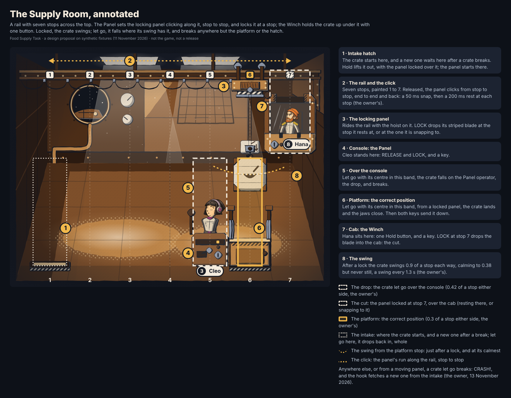
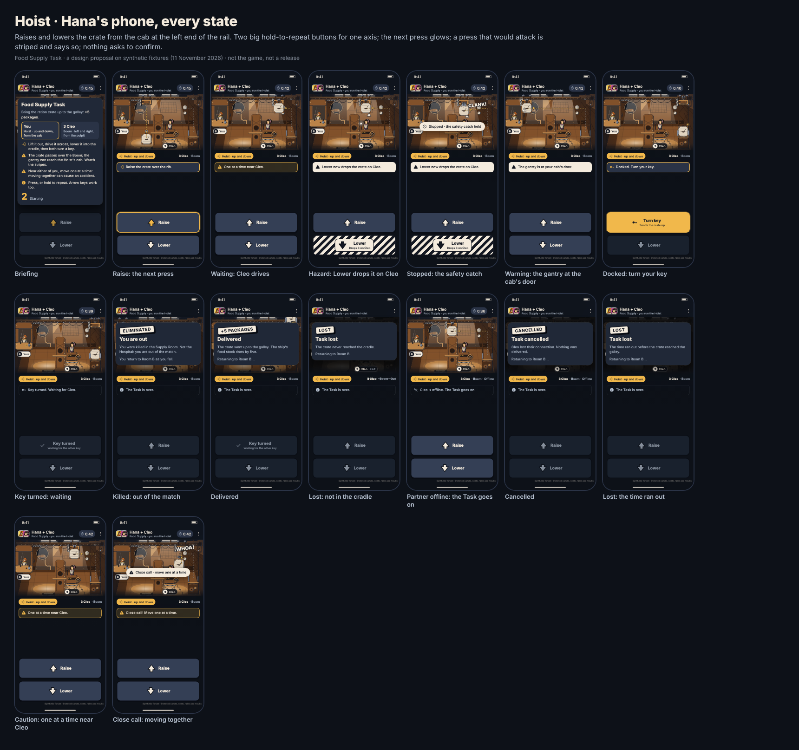
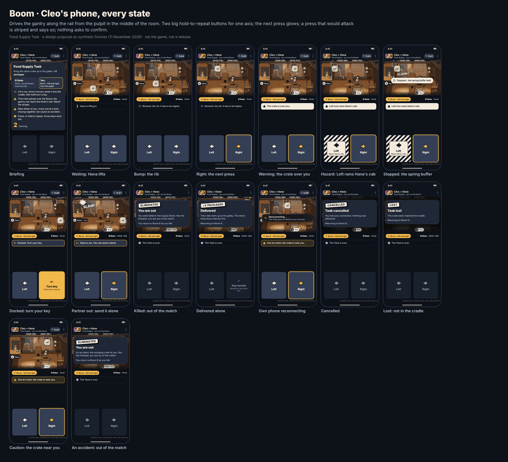
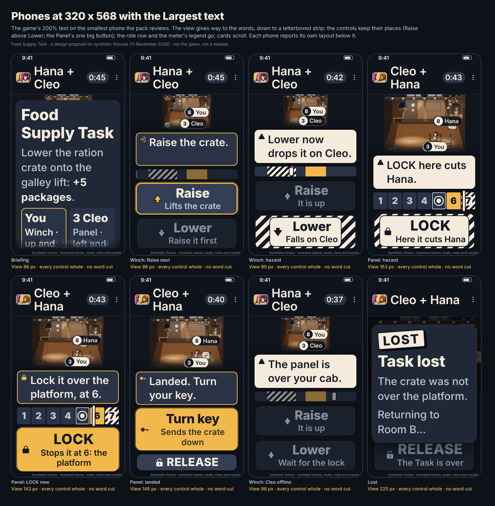
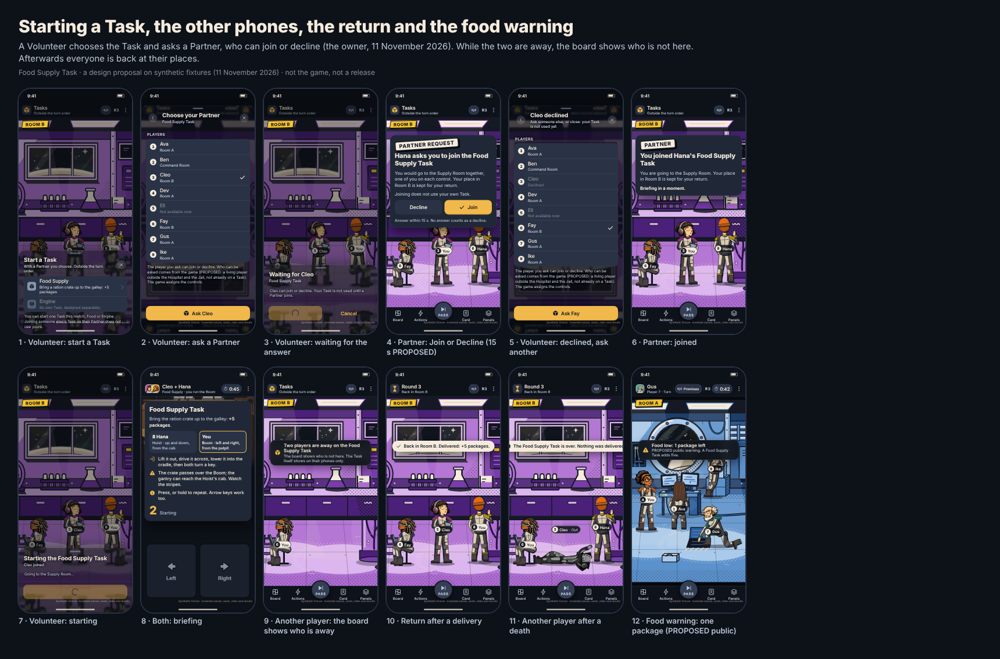
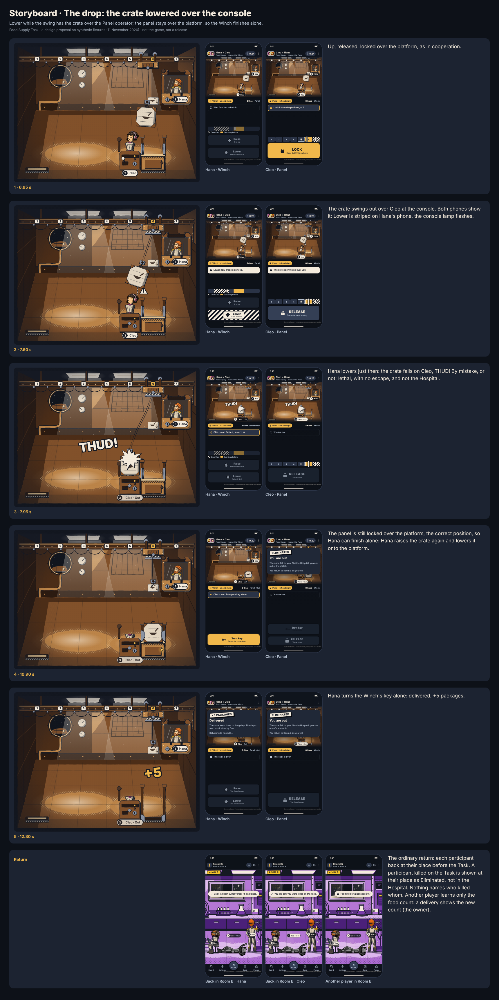
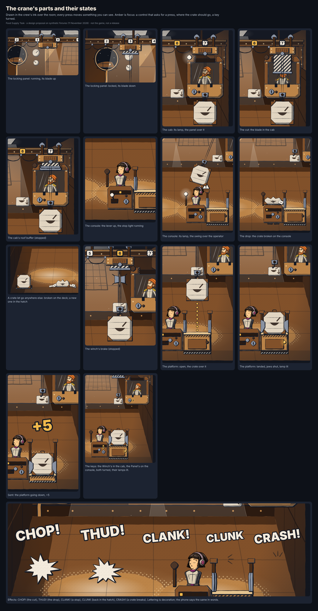
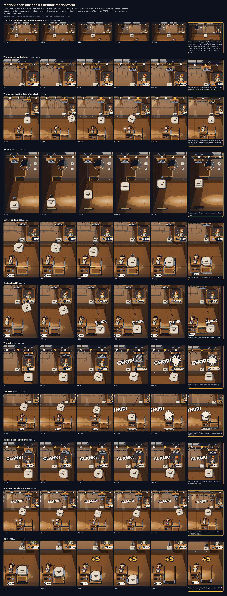

# The Food Supply Task

A two-player Task in the Supply Room, designed from the owner's confirmed highlights of 11 November 2026 ([owner-decisions.md](owner-decisions.md#11-november-2026-the-food-supply-task)). **A design proposal on synthetic fixtures. It activates no gameplay and is in no release.** Every choice of the design's own is marked PROPOSED; the rest follows the confirmed rules.

| | |
| --- | --- |
| Base commit | `8cbe5e896e2fa84f8d7c9df8da0b21cc9d55359d` (`main`, after PR #225), in its own worktree on `claude/designer-food-supply` |
| Ruleset in force there | `in-person-planet-blackout-before-vote-2026-11-10` (engine `planet-game-1.3.0`, protocol 3): `rules/planet-successor-blackout-before-vote-authority-2026-11-10.json` and `rules/overlays/planet-blackout-before-vote-owner-decision-2026-11-10.json`, over the successor authority `in-person-planet-2026-11-05` |
| Rule source for this Task | The owner's highlights of 11 November 2026 only. No Task, Food or Supply Room rule exists under `rules/` at the base commit |
| The owner's detailed handoff | `docs/design/food-supply-requirements-2026-11-11.md` and `food-supply-concepts/` are on the owner's computer and were not available to this session. This design follows the confirmed highlights; it will be reconciled with that file when it is shared |
| Fixtures | The phone pack's invented roster: Hana (seat 8) runs the Hoist, Cleo (seat 3) the Boom, both from Room B |
| Runner | A Claude Code session acting as Visual and Motion Designer |

## The concept

**A gantry crane, seen from the side, that two people must work together and either can turn on the other.** The Supply Room is a cargo bay. A ration crate rises out of an intake hatch in the deck; a gantry on a ceiling rail carries it across the room, over a hull rib, to the galley lift; lowered into the lift's cradle, it is clamped, and when both operators turn a key, the lift sends it up to the galley: **+5 packages**.

- **The Hoist** (vertical) sits in a cab hung from the left end of the rail and raises and lowers the crate on its cable.
- **The Boom** (horizontal) stands at a pulpit in the middle of the room and drives the gantry left and right.

Neither can deliver alone: the crate has to go up before it can cross the rib, across before it can go down, and down before the keys work. Nine presses and two keys, in an order both phones light up. The puzzle is simple on purpose; **the challenge is trust**, because the same two buttons that deliver the crate can kill:

- **The drop.** The route passes over the Boom operator's head. With the crate hanging there, the Hoist's Lower drops it on them.
- **The ram.** The gantry's left end carries a bumper plate. Driven into the column of the Hoist's cab, it slams into the cab.

Both are ordinary presses of the attacker's own control. Both phones see each danger coming one press ahead: a flashing lamp, a warning mark, and on the attacker's phone the very button striped and saying what it will do. Nothing asks to confirm; the press acts.

**Machinarium as inspiration, Mothership as the look.** Every press turns something you can see: a drum winds, wheels turn, the cable sways, a clunk when something blocks. Causes and effects are mechanical and visible, never explained by text alone. The drawing is the crew's own ink and noir light, the rooms' halftone, the comic lettering of the board (THUD!, SLAM!, CLANK!) and the phone pack's interface.

### The room, on a grid

The machine works on a plane of **7 columns and 4 rows**. Every press moves one step. Columns are numbered 1 to 7 here and on the sheet (0 to 6 in the handoff); rows are 0 to 3, with row 0 on the deck.

| Column | What stands there | Why it matters |
| --- | --- | --- |
| 1 | **The Hoist's cab**, rows 2 and 3 | The ram's target: the gantry entering this column |
| 2 | **The cab's door** | The gantry here is one Left from the ram: the cab's lamp flashes on both phones |
| 3 | **The intake hatch**, row 0 | The crate starts here; it rests on the deck only here, and cannot be dragged while in it |
| 4 | **The rib**, rows 0 to 2 | The crate crosses only at the top row |
| 5 | **The pulpit and the Boom operator**, rows 0 to 2, head at row 2 | The drop: the crate lowered from row 3 here |
| 6 | Open deck | Free |
| 7 | **The galley lift**: the cradle at row 1, its machinery at row 0, the end stop and the Boom's key at the rail's end | The cradle is the correct position; the end stop turns the Boom's key |

The precise boxes, cells and regions (in the 1024 × 768 picture) are in [handoff.json](../../design/food-supply/handoff.json) (`plane`, `boxes`, `regions`) and in `design/food-supply/layout.mjs`.

**The route** (3 Raise, 4 Right, 2 Lower, two keys) crosses the Boom's own column at the top row: **the Boom must trust the Hoist for one step**, and the Hoist must trust the Boom whenever the gantry can reach the cab. **The correct position for a survivor is the cradle**: there the crate is clamped and both mechanisms are free, so a survivor's key alone sends it.

## The phones

Each participant's phone shows the same view of the Supply Room, then their own controls: **two big buttons for their own axis, and nothing else**.

| Part | Behaviour |
| --- | --- |
| Top bar | The pack's pair bar: both participants, "Food Supply · you run the Hoist", the Task's time |
| View | The machine's part of the room, the same crop on both phones, with the pack's name tags (you in paper). An image with a text equivalent: where the crate and the gantry are, and whether a warning shows |
| Role row | "Hoist · up and down" and the partner, with Out or Offline |
| Hint | One line: the next press, a wait, a warning, a bump's reason, a stop. A polite live region. At most 40 characters, so it fits three lines at the largest text |
| Controls | Raise above Lower (the Hoist); Left beside Right (the Boom). One press, one step; holding repeats (PROPOSED every 300 ms, the server's own interval). Arrow keys on the participant's own axis |
| The next press | Glows (an amber ring), from the cooperative route |
| A press that attacks | **Striped like the room's hazard markings**, and it says what it does: "Lower · Drops it on Cleo", "Left · Rams Hana's cab". Its accessible name says the warning. No confirmation, no arming |
| Keys | Docked, the Hoist's Raise becomes **Turn key**; at the end stop, the Boom's Right does. Turned: **Key turned**, waiting for the other |
| Cards | The briefing (who runs what, the route, the stripes, the countdown); **You are out** for the victim (killed in the Supply Room, not the Hospital, out of the match); **Delivered** (+5 packages); **Task lost**; **Task cancelled**. After a kill, the card waits for the impact to play (0.9 s), so both see the cause first. Then the return |
| Banners | "Stopped · the safety catch held" (or the spring buffer); "Reconnecting… The Task goes on without your presses" on a participant's own phone when it loses the connection |

**Large text.** At 320 × 568 with 200% text, the view gives way to the words, down to a 112-pixel letterboxed strip; the controls keep their places and grow; the role row goes (the buttons, hint and tags say the same); cards scroll. Each phone measures itself on the sheet: every control whole, no word cut, no hint scrolling.

**Before and after the Task**, outside the Task space:

1. **The Volunteer** opens Tasks, outside the turn order, and chooses Food Supply. The sheet says each player can start one Task per match, Food or Engine, and that joining as a Partner does not use theirs.
2. **Asks a Partner** from the players (PROPOSED: a living player outside the Hospital and the Jail, not on a Task), then waits; Cancel withdraws the request.
3. **The Partner can join or decline** (the owner's decision). The request says who asks, that their place is kept, and that joining does not use their own Task. PROPOSED: 15 s to answer, and no answer is a decline.
4. **After a decline**, the Volunteer sees who declined and asks someone else, or closes. The Volunteer's Task is used only when a Partner joins (PROPOSED). The request and its answer stay between the two (PROPOSED).
5. **Both are briefed** (PROPOSED 4 s), then play (PROPOSED 45 s).
6. **Other players** never see the Supply Room. Their board shows the two places empty, so anyone can tell who went (the owner's decision); a banner says only that two players are away on the Food Supply Task. PROPOSED: the result shows only as the food stock.
7. **The return**: each is back at their place; a participant killed on the Task lies there, Eliminated, as the board draws any death.
8. **The food warning**: "Food low: 1 package left" (PROPOSED: on every phone).

## Storyboards

Each storyboard is a scripted run of presses played through the design's mechanics model (`design/food-supply/task.mjs`), so every frame shows what the rules give. Each beat shows the room, both phones and a caption; the boards that end in a return show the return. Each also exists as a silent film, at normal motion; cooperation and the drop also with Reduce motion.

| Storyboard | What happens | Sheet | Film |
| --- | --- | --- | --- |
| Cooperation | Lift, an early Right bumps the rib, across, into the cradle, two keys: delivered | [board-cooperation](../../design/food-supply/review/board-cooperation.png) | [film](../../design/food-supply/review/film-cooperation.mp4), [reduced](../../design/food-supply/review/film-cooperation-reduced.mp4) |
| The drop | The crate over the Boom; the Hoist's Lower: THUD!, lethal; the crate on the pulpit, lost | [board-drop](../../design/food-supply/review/board-drop.png) | [film](../../design/food-supply/review/film-drop.mp4), [reduced](../../design/food-supply/review/film-drop-reduced.mp4) |
| The ram | The gantry back to the cab's door; the Boom's Left: SLAM!, lethal; lost | [board-ram](../../design/food-supply/review/board-ram.png) | [film](../../design/food-supply/review/film-ram.mp4) |
| Survivor completion | Docked; the Hoist's key turned; the Boom rams instead; the crate stays clamped; the Boom's key alone sends it | [board-survivor](../../design/food-supply/review/board-survivor.png) | [film](../../design/food-supply/review/film-survivor.mp4) |
| Protection against the drop | The cable's safety catch stops the crate: CLANK!, STOPPED; the Task goes on to a delivery | [board-protection-drop](../../design/food-supply/review/board-protection-drop.png) | [film](../../design/food-supply/review/film-protection-drop.mp4) |
| Protection against the ram | The cab's spring buffer stops the gantry: CLANK!, STOPPED; delivered | [board-protection-ram](../../design/food-supply/review/board-protection-ram.png) | [film](../../design/food-supply/review/film-protection-ram.mp4) |
| Lost: the time runs out | The crate left over the open deck; the timer runs down | [board-timeout](../../design/food-supply/review/board-timeout.png) | [film](../../design/food-supply/review/film-timeout.mp4) |
| Disconnect | Cleo's phone drops; the Task runs on through the grace; cancelled; both return | [board-disconnect](../../design/food-supply/review/board-disconnect.png) | [film](../../design/food-supply/review/film-disconnect.mp4) |

## Artwork

The room is drawn flat and inked by the rooms' own pass (`design/room-pilot/ink-room.mjs`) in a rust family of its own (PROPOSED: deep `#2B1A10`, shadow `#4C2D17`, mid `#82512A`, light `#BC8448`, pale `#E6C590`), with the shared ink and paper and the pack's accent `#F1B84B` for focus. The still picture is exported as [art/supply-room.back.svg](../../design/food-supply/art/supply-room.back.svg). The moving parts are drawn per pose in the crew's ink by `design/food-supply/machine.mjs`, and the operators are the crew rig's figures: the Boom standing at the console, the Hoist seated in the cab; down, each slumps over their own controls, as the board draws an Eliminated figure, with no wound and no mark.

Layer order, back to front: the room; the cab's back; the Hoist; the cab's front (window, lamp, key, spring buffer); the festoon cable; the gantry (drum, wheels, bumper plate); the Boom's key at the end stop; the cradle's back; the Boom; the console; the cable and hook; the drop line; the crate; the cradle's jaws; the ram's warning mark; the route guide; the effects; the name tags.

## Motion

All timings PROPOSED. **Presentation only**: a cue never delays a press, and a new authoritative state always replaces a cue still playing.

| Cue | Time | Easing | Reduce motion |
| --- | --- | --- | --- |
| Move one step (crate or gantry; the drum and wheels turn) | 240 ms | in-out | The part at its new place at once |
| Sway of the hanging crate after a move | 700 ms | | None |
| Bump: a blocked move | 180 ms | | A clunk mark at the contact for 400 ms; nothing moves |
| The drop | 160 ms | in | The crate on the pulpit at once; THUD! shown still |
| The ram | 140 ms | in | The gantry at the cab at once; SLAM! shown still |
| Stopped (the safety catch or the spring buffer) | 320 ms | | The catch shown thrown out, still, with CLANK! for 600 ms |
| Impact (the burst grows, the lettering holds) | 900 ms | out | The burst and the lettering still for 900 ms |
| Dock (the jaws shut) | 140 ms | | The jaws shut at once |
| The empty hook rises | 300 ms | | At the gantry at once |
| A key turns, its lamp lights | 140 ms | | Turned and lit at once |
| Send (the cradle rises, +5) | 1100 ms | in-out | The cradle gone at once; the +5 stamp still |
| A warning (the lamp flashes) | 330 ms on, 330 ms off | | The lamp lit steadily; no flashing; the warning mark shown |
| The ending dim | 600 ms | | Dimmed at once |

The warning lamp flashes 1.5 times a second, well under three. Nothing shakes. Reduce motion keeps every state and every word; it removes travel, sway, growth and flashing. The prototype draws a key turned at once; the 140 ms turn is the specification.

## For Frontend

- **The view.** One SVG scene per state (`sceneSvg` in `design/food-supply/scene.mjs` is the reference), cropped to `[16, 44, 992, 612]` of the 1024 × 768 picture, in a box that keeps its aspect and letterboxes when the panel needs the height. The name tags are the pack's `.tag`, placed from `tags` in the handoff; the Hoist's starts at the cab's left edge.
- **The panel** is a column under the view: hint, then the controls at the bottom. The phone CSS (`design/food-supply/phone.css`) is the specification: the view gives way first (flex-shrink), down to 112 px; only the hint may scroll, and at the reviewed sizes it never does.
- **Controls.** Pointer down acts at once and starts the repeat; pointer up or leave stops it. A repeat stops when the button turns into a warning; to act on the warning, press again. Send each press with `shown` (the button showed the warning) and `repeat` (PROPOSED command fields, below).
- **States to draw**, from the projection: the buttons (`hazard`, `next`, `key`, `enabled`), `warnings`, `docked`, `keys`, `you`, `partner`, `secondsLeft`, `briefingLeft`, `outcome`. The storyboards' sheets show each.
- **Never show** an attack opportunity, Protection or a reason for a stop. "Stopped" is the same words whichever caused it.
- **Accessibility.** Each button's name includes its warning; the view's text equivalent; the hint's live region; arrow keys; large text as above; Reduce motion as above.

## For Backend

The design's mechanics model, `design/food-supply/task.mjs`, is a reference, not the engine: Backend implements the rules; this fixes the geometry and the cause and effect so the phones, the storyboards and the tests agree.

- **State** (`state` in the handoff): phase, seats, the gantry's column, the crate's cell, docked, keys, alive, online, the deadline and the outcome, all seen by both participants; the attack opportunities, Protection and each participant's last accepted press, held by the server only.
- **Start**: the server passes each participant's attack opportunity in as it holds it; **the design never resets it** (its scope is the owner's open question). Protection is read as the existing rules decide, at the moment of the press.
- **One press** (`act`): refused (briefing, too soon, down, ended, not your axis, stale, repeat), or one of MOVED, BUMPED (with why), DOCKED, KEY, KEY_RELEASED, STOPPED, KILLED (then lost unless docked), SENT and ENDED. The events and their visibility are listed in the handoff (`events`).
- **Deliberate attacks only (PROPOSED).** A press attacks only if it is a fresh press on a button that showed the warning. A press made on an older picture (another press moved the crate over the Boom first) or a hold's repeat is refused instead. The flags can only stop the presser's own attack; the server's state decides everything else. This keeps a network race or a held button from killing by accident, and it is not a confirmation: one press of the same button acts.
- **Clock**: the briefing's end, the deadline (lost: time), the grace (cancelled: disconnect).
- **Connection**: out of contact, the Task runs on through the grace (PROPOSED 8 s); back in time, nothing paused; out longer, cancelled. A death that resolved first stands.
- **Command**: `TASK_MOVE { taskId, dir, shown, repeat }` (a proposal for the shared contract; Integration owns `packages/contracts/`). The answer is the new state with its events to both participants; a refusal to the presser only.
- **Asking a Partner** (proposals, around the owner's decision that a Partner can decline): `TASK_ASK { kind, partner }` from the Volunteer, `TASK_ANSWER { askId, join }` from the asked player within the answer time, `TASK_ASK_WITHDRAW { askId }`; events `TASK_ASKED` to the asked player, `TASK_DECLINED` to the Volunteer (a decline or no answer), `TASK_STARTED` to both. The Volunteer's initiation is spent on `TASK_STARTED` (PROPOSED). Details in the handoff (`controls.ask`).

## For Game Balance

- **The survivor asymmetry** (conflict 2): only the Boom can kill and still deliver.
- **Timing**, all PROPOSED: 15 s for a Partner to answer, 4 s briefing, 45 s deadline (the route itself is eleven presses, a few seconds of play), 8 s grace, 300 ms between presses.
- **The food economy**: five packages, five per delivery, one dose per player at each Eating step, one Task initiation per player per match. How often Eating comes decides whether Tasks can keep up; with the stock short, the Eating order decides who goes to the Hospital.
- **Trust windows**: the Boom is exposed for one step (the crossing); the Hoist whenever the gantry can reach the cab, and most after docking, when the ram also delivers.

## Visibility

| Who | Sees |
| --- | --- |
| The two participants | The whole Supply Room: every move and bump, both warnings, both keys, the time, each other's alive or offline state, and a STOPPED alike with no reason. Never an attack opportunity, Protection, or the other's refused presses |
| Every other player | Never the Supply Room. Who is away, from the board: the two places are empty (the owner's decision); the banner names no one. PROPOSED: the result only as the food stock shows it (delivered or not), never how it went. PROPOSED: not who was asked, or who declined |
| A death | Shown on the return as any death: Eliminated at the participant's previous place. No phone says who, how, or that the Task did it |
| Protection | Never shown |
| The food stock | PROPOSED public: the count (the ship-life food capsules) and the warning at one package |
| Only the server | Attack opportunities, Protection, and why a STOPPED happened |

## Acceptance scenarios

Twenty-five, each a start, a list of timed steps and what must follow, in [handoff.json](../../design/food-supply/handoff.json) (`acceptance`) and `design/food-supply/scenarios.mjs`. `packages/design-tokens/test/food-supply.test.mjs` plays each through the mechanics model.

| Scenario | Given and when | Then |
| --- | --- | --- |
| cooperation | The route, with an early Right into the rib | Delivered, +5, both alive; a bump; no stop, no kill |
| drop | The crate over the Boom; Lower | The Boom killed; lost (not in the cradle) |
| ram | The gantry at the cab's door; Left | The Hoist killed; lost |
| survivor | Docked, the Hoist's key turned; the Boom rams, drives back, turns its key | The Hoist killed; delivered alone |
| protection-drop | The Boom Protected; Lower over the Boom | STOPPED; both alive; delivered later |
| protection-ram | The Hoist Protected; Left at the door | STOPPED; both alive; delivered later |
| timeout | The crate left over the open deck | Lost (time) |
| disconnect | The Boom offline past the grace | Cancelled (disconnect, the Boom); both alive |
| briefing-refused | A press in the briefing | Refused; nothing moves |
| too-soon | Two presses inside the interval | The second refused; the third moves |
| not-your-axis | The Hoist presses Left | Refused |
| intake-holds | Right while the crate sits in the hatch | A bump |
| rib-blocks | Right at row 1 | A bump (the rib) |
| pulpit-blocks | Lowered over open deck, then Left toward the pulpit | A bump (the pulpit); no stop, no kill |
| no-opportunity | The Hoist with no opportunity left lowers over the Boom | STOPPED, exactly as Protection |
| blocked-twice | The Boom Protected; two Lowers | Two STOPPED; no kill |
| key-release | The Boom's key turned, then Left | KEY_RELEASED; nothing sent |
| docked-hoist-down | Docked; Lower | A bump (the cradle) |
| reconnect-in-grace | Offline, back inside the grace | Goes on; nothing paused |
| death-stands | The Boom offline; the drop lands in the grace | Lost (not in the cradle), not cancelled |
| offline-victim-docked | Docked; the Hoist offline; the ram | Delivered alone; the death stands |
| dead-cannot-press | The Hoist killed; the Hoist presses | Refused (down) |
| race-refused | Lower pressed on the old picture as the Boom drives the crate over itself | Refused (stale); a fresh Lower on the warning drops it |
| hold-stops-at-warning | A held Lower's repeat reaches the warning | Refused (repeat); no stop, no kill |
| cancel-without-death | The Hoist offline for the whole grace | Cancelled; both alive |

## Genuine rule conflicts

Four tensions inside the confirmed rules, each with a solution that stays inside them. The owner decides whether each solution stands.

1. **No escape, and a disconnect cancels.** If a disconnect cancelled at once, switching off the network would escape an attack. **Solution:** the server judges a disconnect only after a grace (PROPOSED 8 s) in which the Task runs on and an attack resolves; a death before the cancellation stands. *Left open:* a participant can still end a Task they dislike by staying offline; whether that should cost anything.
2. **Both can betray, and a survivor completes only from the correct position.** The drop puts the crate onto the Boom, out of the cradle, so a Hoist who drops can never complete; only the Boom's ram after docking kills and still delivers. **Solution:** the server assigns the controls at random (PROPOSED), so neither player picks the stronger seat; both phones show both risks equally; the two-key send makes docking a visible standoff. *Left open:* accepting the asymmetry, for Game Balance and the owner.
3. **Protection applies, and Protection is not disclosed.** An attacker who knows they still had their opportunity learns from a failed attack that the victim is Protected. **Solution:** one STOPPED, identical for Protection and for a spent opportunity, with no reason on either phone; the victim cannot tell which; no one else learns anything. The attacker's inference cannot be removed without a third cause for a stop, which the rules do not have. *Left open:* the owner confirms that inference is acceptable.
4. **No automatic attribution, and the return shows the dead.** With two participants, the survivor is the only possible killer to anyone who knows who went. **Solution:** no phone states a killer, a cause or a Task death. *Settled:* the owner decided that other players can see on the board who is away, so after a death everyone can work out the survivor. That is accepted, and nothing states it.

## Open items

| Item | For |
| --- | --- |
| The attack opportunity's reset scope across repeated Task participation (not chosen anywhere in the design) | The owner |
| Whether a blocked attack spends the opportunity (PROPOSED: yes) | The owner |
| Whether one dose is one package (PROPOSED: yes) | The owner |
| When the initiation is spent (PROPOSED: when a Partner joins and the Task starts, so a decline does not spend it; a Task cancelled by the Partner's disconnect gives it back, by the Volunteer's own does not) | The owner |
| Whether a deliberate disconnect costs anything (conflict 1) | The owner |
| Who can be asked as a Partner (PROPOSED: living, outside the Hospital and the Jail, not on a Task), the time to answer (PROPOSED: 15 s, no answer declines), and asking the same player again after a decline (PROPOSED: not for this start). That a Partner can decline is decided | The owner |
| Who runs which control (PROPOSED: the server at random; conflict 2) | The owner |
| Whether others learn the result (PROPOSED: only as the food stock shows it). That they can see who is away is decided | The owner |
| When a Task may start, and whether two may run at once | The owner, Backend |
| The timing (15 s, 4 s, 45 s, 8 s, 300 ms) | Game Balance |
| The survivor asymmetry and the food economy | Game Balance |
| The Eating step's place and order | The owner, Game Balance |
| Deliberate attacks only (PROPOSED) | The owner, Backend |
| `TASK_MOVE`, the Task projection and the ruleset version that adopts this Task | Integration |
| The Engine Task (not designed here) | The owner |

## Review files

| File | What it is |
| --- | --- |
| [review/layout.png](../../design/food-supply/review/layout.png) | The room annotated: grid, regions, route, callouts |
| `review/board-<id>.png` (8) | Each storyboard, beat by beat, with both phones and the return |
| [review/phones-hoist.png](../../design/food-supply/review/phones-hoist.png), [review/phones-boom.png](../../design/food-supply/review/phones-boom.png) | Every state of each participant's phone |
| [review/flow.png](../../design/food-supply/review/flow.png) | Starting a Task, the Partner, the other phones, the return, the food warning |
| [review/machine.png](../../design/food-supply/review/machine.png) | The machine's parts and their states |
| [review/motion.png](../../design/food-supply/review/motion.png) | Each cue's frames and its Reduce motion form |
| [review/large-text.png](../../design/food-supply/review/large-text.png) | 320 × 568 at 200% text, each phone's measured layout |
| `review/film-<id>.mp4` (10) | The storyboards as silent films; cooperation and the drop also with Reduce motion |
| [review/renders.json](../../design/food-supply/review/renders.json) | Each file's SHA-256 and the browser |

To regenerate: `node design/tools/food-supply-export.mjs` (the art and the handoff; `--check` compares), `node design/tools/food-supply-render.mjs --sheets --films` (needs Chromium and ffmpeg). The pages themselves: `design/food-supply/review.html`, `phone.html` (`?s=task&board=drop&t=7300&as=hoist`, `&text=2`, `&motion=reduced`, `&live=1`) and `film.html`.

**Limits.** Rendered in desktop headless Chromium at each page's CSS size: not a phone, not a real network, not a playtest. The films are silent. The mechanics model and the scenarios show the design is consistent; they do not show that the Task is fun, fair or balanced with real people, and they are not the engine.
