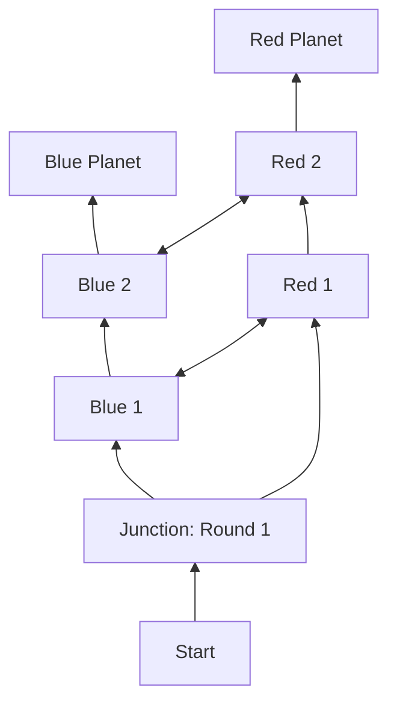

# Owner decision record — 25 October 2026

Status: owner-confirmed design reference; gameplay integration pending. Recorded from the GameN design conversation `01a14f15-9d9a-7811-b0e2-477b23bd9f1b`, including the final correction removing Alien's full-Code starting information. This record does not claim a gameplay release or balance validation.

The machine-readable [navigation and Code overlay](../../rules/overlays/planet-navigation-code-owner-decisions-2026-10-25.json) is the latest rule authority for the changes below. Earlier overlays and source snapshots are retained as evidence. The Design Studio at `/development/design-studio/` remains the editable owner reference.

## Spaceship navigation and victory

- The match ends at Blue Planet or Red Planet; that planet's team wins. The five-round cap, old power comparison, direct Code victory, elimination-only endings and Final Showdown are removed from this design.
- Calculate direction after action results and Jail voting, using the locations then. Only A/B occupants contribute automatically toward their hidden team. Alien contributes to neither side. Captain's 2x contribution is automatic, not a selectable vote.
- Only Captain and Officer see the final computed direction. Neither receives numbers, separate Captain weight or pre/post comparisons. Captain confirms, then Officer confirms; neither has a veto. If tied, Officer chooses the direction first, then both confirm it in that order.
- Move exactly once per round. Round 1 is Start to Junction. From Junction, each Y arm has two intermediate spaces and the planet as its third space. Earliest arrival is Round 4.
- Changing sides crosses to the other arm at the same depth. It does not move backward or reset progress. Example: Junction → B1 → B2 → R2 → Red Planet. The owner explicitly accepted that Red can use progress previously made toward Blue.
- Alien co-wins with either destination team if alive at arrival and has personally used Blackhole. Being alive without Blackhole is insufficient. No extra Healthy-only requirement is added.

Vertical links advance on the current side; horizontal links switch sides and each consumes that round's one movement.

## Soldier Blue

The ninth secret role stays Blue and has no starting weapon. Its once-per-match Role Action fixes the players currently in the opposite A/B room. Those identities lose navigation weight through that round, even if they move; later arrivals are not included. Captain, Jail and all other ballots are unaffected. The earlier Vote Disruption wording is superseded. Ordinary Supplier weapon access remains.

## Code and Hacker progression

Code is the unordered set of the original player numbers of **Undercover, Alien, Insider and Cracker**. These are player numbers, not four role-name strings. Membership does not change when a member is eliminated or moved offboard.

| Stage | Confirmed behavior |
| --- | --- |
| Scan | Select an eligible player and guess faction. A correct guess returns only Code membership privately. A wrong guess gives no Code information, spends the current Scan and disables Scan for the whole next round. It returns the round after that; earlier information is retained. |
| Submit Code | One final four-number submission in the entire match, from Round 2 onward before navigation. A wrong Code consumes this opportunity and does not unlock the spaceship hack. |
| Unlock | Correct Code permanently replaces the Scan button with **Hack Spaceship**. No Scan remains. Unlocking does not automatically activate the hack or change movement. |
| Activate | One use in the entire match at the Hacker's chosen eligible pre-navigation time. Force Red direction for that round, using the normal single Y-route move. At B2 it switches to R2; at R2 it reaches Red Planet. The button stays disabled after use. |

The final submission limit and later activation limit are separate. Discovery may use Scan, discussion and deduction; the owner did not require four successful Scans. **Standard Hack** remains the separate shared private-conversation action.

## Starting information

| Role | Starting information / direct consequence |
| --- | --- |
| Insider | Receives the three identities of Undercover, Alien and Cracker without their role mapping. Adding their own number gives the complete Code. |
| Alien | No longer receives Code. Knows only their own Code membership from the fixed public composition. |
| Hacker | Knows Undercover's identity and therefore one confirmed Code member. |
| Red Disabler | Knows Undercover's identity and therefore one confirmed Code member. |
| Undercover and Cracker | Each can infer their own membership from the fixed Code composition; no extra identity packet is added. |
| Other roles | No extra secret starting information is introduced. |

## Four event records retained

The full records remain in Design Studio's **Development Ideas** tab. This list carries their confirmed essentials forward; the latest navigation, Code and Alien victory corrections take precedence.

1. **Spaceship Commander:** Captain and Officer are public offices over secret roles. Captain appoints one other Officer before turns; the appointment lasts until the Captain term ends. Officer chooses a public voluntary-movement block before the first turn; no selection means no block. It expires at round end, cannot repeat the same target in consecutive rounds, may target Captain or another room, and does not stop forced Hospital/Jail transfers. Jail/Hospital deactivate this power. Public and Role Action allowances remain separate. Captain is yellow; the removed Blue Officer secret role does not return.
2. **Promises:** during permitted private talk, choose one of six fixed cards: Captain Support, Officer Selection, Jail Vote, No Jail Vote, Meet in A, Meet in B. Acceptance consumes one outgoing slot for the giver and one incoming slot for the recipient for the whole match. Rejected drafts do not count. Both retain the private record and result; actions are never forced. Results are Pending, Fulfilled, Not fulfilled and Condition not met for the conditional Officer promise. Captain Support/Jail Vote use actual votes; Officer Selection applies at the next election/appointment; room meetings use location when voting begins. No Jail Vote means not voting to jail the recipient that round.
3. **Blackhole Parallel Events:** Alien's once-per-match Role Action while Captain or Officer, secretly activated before turns. A/B crossing creates an actor reality; ordinary movement limits remain. Actions and their costs belong to the actor reality; chats continue. No early announcement or branch labels. After the last turn, black screen, luminous BLACKHOLE title and the spaceship animation precede a uniform random selection of one whole reality and Sync before voting. Hospital/Jail do not create branches. Movement spent, accepted-promise quotas, Hospital-panel attempts and Blackhole use stay global; discarded reality effects are not mixed into the chosen state. Alien victory uses the revised either-planet prerequisite above.
4. **Windows:** A↔B, A↔Hospital and B↔Jail. Anyone at an endpoint can open that window's 2D view freely during the round, including Hospital/Jail occupants. Four drawing seats: each room's seat nearest the door serves the other room; A has a separate Hospital seat and B a separate Jail seat. Only its occupant draws for that window, with arbitrary pictures/text. Draw locally and press Show; author/time order remains. No eraser or replacement. Leaving the seat does not remove images; later occupants can add. Every image expires at the end of that same round.

## Hospital panel retained

A living Hospital patient may make one lifetime attempt using Cracker's player number. Wrong input spends only the attempt. Correct accepted input reserves one of the two heals shared with Cracker and queues self-Rescue for that round's Rescue stage; it does not instantly heal or revive. During Blackhole the healing pool is per reality and only the chosen pool/effects survive, without refills; the patient's attempt remains spent globally. See the [panel](../../rules/overlays/hospital-panel-owner-decision-2026-10-25.json), [healing inventory](../../rules/overlays/hospital-panel-blackhole-owner-decision-2026-10-25.json) and [attempt](../../rules/overlays/hospital-panel-attempt-owner-decision-2026-10-25.json) decisions.

## Open details, not approved defaults

- Confirmation deadlines and unavailable/vacant office handling; Captain multiplier interaction with suppression; public ship-progress and disruption notifications.
- Exact integration of pre-vote Blackhole Sync, action resolution and post-results navigation.
- Legacy Supplier, shooting, Clone, medical and conversation rules tied to specific rounds. No new windows are inferred from removing the match cap.
- Hack Spaceship action cost, precise eligibility and whether it can activate in the same round as the last Scan. The proposed Role Main Action cost was never approved. Button replacement does not settle that cost.
- Scan availability after a failed final Code submission; exact Blackhole handling of Code attempt, unlock, cooldown and activation state.

Historical runtime remains protocol 2 / `full-game-1.11.0` / `in-person-v1-hospital-four-2026-10-19`. No gameplay tests or engine changes are part of recording these decisions.
