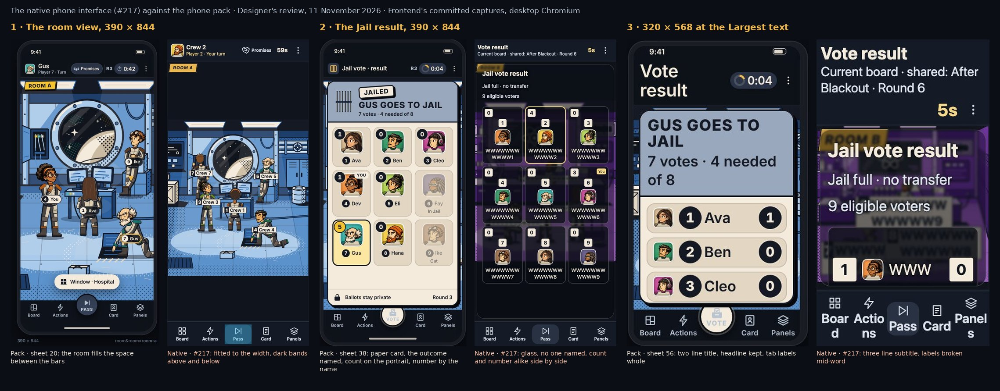

# The native phone interface: Designer's visual review

**11 November 2026. Status: not accepted yet.** For Frontend, with Integration. Integration's review of [#217](https://github.com/Amirkianfar66/GameN/pull/217) notes that Designer's visual acceptance of the native interface had not been received; this is it.

The native interface follows the phone pack on the glass, the large-text lists, the counts, the Blackout-before-vote sequence and the role stage's timing. It differs from the pack on four things every player sees each round: the room's framing, the tab bar, the top bar at large text and the results. Designer accepts it once those four are changed. The other eight can follow.

Since then the owner has decided that the pack is the specification for the phone interface, and that Designer's visual acceptance comes before a phone-interface merge ([owner-decisions.md](owner-decisions.md#11-november-2026-the-build-follows-the-pack)).

## What was reviewed

- **The native interface** on `main` at `d574d371` (after #217 and #220), through Frontend's committed captures in desktop Chromium and their `facts.json`:
  - `docs/frontend/evidence/pre-vote-consumer-2026-11-11/presentation/`, source `b63403e6`: ballots, results, the glass and keyboard focus at 320 × 568 with 200 % text and at 390 × 844, with 7–9 players, both motion settings and the solid fallback;
  - `…/synthetic/`, source `c5a70b7e`: the five rooms at 100 % and 200 % text, and the Blackout-before-vote sequence;
  - `…/round-order/`, source `d1a03c87`: the Round order panel;
  - `docs/frontend/evidence/phone-ui-2026-11-10/controls-follow-up/`, source `838558bd`: Actions, Panels, Scan, the Hospital's targets and the dark board;
  - `…/synthetic/`, source `0af438bc` (earlier): the lobby, the character grid, private talk, Clone and the role stage.
- **Against** the phone pack on `main` (#207): its sheets, the [handoff](phone-ui-handoff.md) and the owner's decisions in [owner-decisions.md](owner-decisions.md).
- **Not checked:** any phone, Safari or VoiceOver; motion and frame rate; anything the captures do not show. The captures come from five source commits. The earliest ones (lobby, private talk, Clone, role stage) may have changed since.

## Accepted

1. **The glass**, exactly as decided: blur 2 px, saturate 1.3, brightness 0.56, the 20–34 % tint and the three-shadow halo under light words (`facts.json`). The room shows through.
2. **Lists at the Largest text on the smallest phone.** Ballots and results become rows of whole names. Each portrait is the size of the seat number beside it and on its line. The count shows once, at the end of the row. Long names wrap instead of being clipped.
3. **Each count once.** There is no "N votes" line, and "You" sits in the cell's top-right corner.
4. **The keyboard.** Every choice is reachable, the check takes focus, and Enter registers the ballot once.
5. **Blackout before the vote.** It is lit for 5 s and dark for 10 s, and every position shows as a neutral ring. The Disabler chooses a position (A1–A5), not a character. The board comes back, then the full 60-second Jail vote and the 5-second result follow.
6. **Targets and Scan.** The Hospital's targets are reachable at 200 % text, with the target list as the text alternative. Scan asks for a guess, checks it in a full sentence, then registers it.
7. **The top bar at ordinary text:** portrait, name, "Your turn", Promises with its word, the clock and ⋮.
8. **The role stage's timing.** The card shows before 20 s and the film after it. Skip does not confirm Ready, and Ready stays a manual tap after the minimum. The lobby and the character grid are as drawn.

## To change before acceptance

1. **Fill the room's space.** The room is fitted to the screen's width, with dark bands above and below it (Room A, Room B, the Hospital and the Jail at 390 × 844). The pack fills the space between the bars at the smallest scale that still fills it, with everyone in view: sheets 20–24 and the owner's "too zoom" decision. The room's own control, such as "Window · Hospital", is missing too. The owner settled how this meets the fixed places in the Blackout on 11 November (T1 in [owner-decisions.md](owner-decisions.md#11-november-2026-the-build-follows-the-pack)): fill, zoom out only to keep a crowd as wide as a full Jail whole, and hold the framing still through the Blackout.
2. **The tab bar.**
   - At 320 px with 200 % text the labels break mid-word: "Boar/d", "Actio/ns", "Panel/s". Keep every label whole on one line, at its ordinary size, as on sheet 56.
   - The open tab is teal (Actions, Panels and sometimes Vote). The pack's selected tab is amber with a filled icon (sheet 08).
   - Pass and Vote are a flat tab. The pack's centre button is raised and round, and amber when it is the player's to press.
3. **The top bar at large text.** At 320 × 568 with 200 % text, the bar takes about 130 px of the 568 at `d1a03c87`: the title, its subtitle ("Round 6", or "Player 6 · Your turn"), then Promises, the clock and ⋮ on a row of their own. At that size the pack gives the title two lines, with the clock and ⋮ beside it, and moves the round out of the bar: sheet 56 and the top bar's rules in [phone-ui.md](phone-ui.md). Frontend's earlier captures were worse: a three-line subtitle ("Current board · shared: After Blackout · Round 6", source `b63403e6`) and the phase said twice ("Blackout · Round 1", then "Before Blackout · Round 1"). The build at `d1a03c87` no longer does either.
4. **Results name the outcome.** The native result says "Jail full · no transfer" or "Player detained", on dark glass. The pack's result is the paper card whose headline names the player and the outcome: "GUS GOES TO JAIL · 7 votes · 4 needed of 8", "GUS CHOSEN · JAIL FULL", "NO ONE GOES TO JAIL", "BEN IS CAPTAIN" (sheets 37 and 38). At the Largest text its stamp and art step aside, but the headline stays (sheet 56).

## To change after

5. **Count and seat number.** In the 3 × 3 result both are the same cream square, side by side above the portrait. The pack puts the count on the portrait's corner, amber for the leader, and the seat number beside the name (sheets 37 and 38).
6. **The words after Register.** Scan says "Registered. Waiting for the authoritative view.", which is developer wording on a player's screen. Each action's state after Register is in the handoff's [After Register](phone-ui-handoff.md#after-register) table. Scan's should say that it is registered and that its private result appears when it arrives.
7. **The Round order panel** is one run-on line. The pack lists each phase on its own row, with an icon and its timing (Panels, then Round order), in the 1.3 order with the Blackout before the Jail vote.
8. **The role card and Ready.** The role is shown as a text panel, and Ready is amber while the card is up, before it can be used. The pack shows the card large (sheets 17 and 31), with Ready dimmed until the film ends.
9. **Cancel while choosing a target.** The centre button becomes "×". The pack keeps Cancel in the targeting bar (sheet 29) and leaves the centre button alone. The owner confirmed the pack on 11 November (T2).
10. **Density.** The Actions and Panels rows are tall and mostly empty. The pack's action tiles carry each action's state, and a Panels row that cannot be used says why (sheets 28 and 32). For Actions, the owner confirmed on 11 November (T3) that every action of the role is a tile, greyed with the server's reason when it is not available.
11. **Name tags at large text.** On the board they are clipped to "Cr…" (source `838558bd`). In Room B at 320 × 568 with 200 % text, the tags of Players 6 and 8 and "You" run into each other (`d1a03c87`).
12. **Clone.** The "CLONE ACTIVE" stamp is drawn over "Clone active through Round 7." (earlier source `0af438bc`).

## Part by part, from the menu to the end

A second pass covered every part of a match. Designer built Frontend's review harness (`apps/game/dev/phone`) at `d1a03c87`, Frontend's last native commit. Its interface code differs from `main` only in the host's abort confirmation, which #220's own captures show. Each state was captured at 390 × 844 and set beside the pack's screen for the same state.

Of the 49 parts, 4 are the same, 8 are close and 37 differ. The pictures are in eight sheets, one for each stage of a match, with the pack on the left and the native interface on the right:

1. [Start: menu, hosting, joining](evidence/phone-ui-native-review-2026-11-11/01-start.jpg)
2. [Before Round 1](evidence/phone-ui-native-review-2026-11-11/02-pregame.jpg)
3. [In the rooms](evidence/phone-ui-native-review-2026-11-11/03-rooms.jpg)
4. [Your turn](evidence/phone-ui-native-review-2026-11-11/04-turn.jpg)
5. [Panels and Promises](evidence/phone-ui-native-review-2026-11-11/05-panels.jpg)
6. [Votes and offices](evidence/phone-ui-native-review-2026-11-11/06-votes.jpg)
7. [Host and connection](evidence/phone-ui-native-review-2026-11-11/07-system.jpg)
8. [End of the match](evidence/phone-ui-native-review-2026-11-11/08-end.jpg)

Three of the native pictures are Frontend's own committed captures: the boarding film, the smallest phone at the Largest text (source `b63403e6`, before the top bar's shorter subtitle), and the host controls in a match.

| Part | The native interface, against the pack |
| --- | --- |
| Brand intro, role films, boarding film | **Match:** the approved films, with Skip. |
| Main menu | **Differs:** titled "Mothership", the project's working name, instead of Game N. Join, Host and Recover are tabs above an open Join form with a "Device" choice. The pack is a menu: Join first and largest, Host second, Recover a quiet link (sheet 10). |
| Host setup and lobby | **Differs:** players and bots are drop-downs, and the seats are folded away ("9 of 9 seats filled"). The pack has 7/8/9 buttons with the team mix, every seat listed and a − / + for bots (sheet 11). |
| Join, waiting, Recover | **Differs:** one code field, a Device drop-down and "Request admission"; the wait reads "Waiting for the server to confirm admission". The pack has a box per code character, Player phone / Shared display, "Ask to join", and "Waiting for the host" with the room and the name. Recover lacks its line on where the code comes from (sheets 12–14). |
| Settings (⋮) | **Differs:** a folded "Display settings" with a checkbox and a drop-down. The pack has a switch and Standard / Large / Largest (sheet 32). |
| Host controls in a match | **Differs:** inside Settings, as "Check server deadline", "Run eligible bots" and "Issue recovery for Player 6". The pack has its own sheet in plain words, with a code for each seat (sheet 15). |
| Character selection | **Close:** the timer is small text under the grid instead of in the header (sheet 16). |
| Role card and Ready | **Differs:** see item 8 above. There is also no "Your film starts in 0:16". |
| Room view | **Differs:** see item 1. The Hospital is the worst case, the ward small at the top over an empty band. Each room's own control is missing: "Windows · 2", "Window · Hospital", "Captain console", "Hospital panel". |
| Private talk capsule | **Differs:** the room fills, but the name tags sit on the bottom edge, away from the two people, and the full tab bar stays. The pack gives the talk its own "Promises" and "My card" (sheet 25). |
| The whole board | **Match** (sheet 26). |
| Pass | **Differs:** "Pass?" alone. The pack says "Pass your turn? The turn goes to Eli · Player 5" and that the move stays open (sheet 27.3). |
| Actions | **Differs:** only the offered actions, one tall row each, in an otherwise empty full-height sheet. The pack shows every action of the role as a tile with its state ("2 injections", "Once a round", "From Round 4"), in a sheet that leaves the room in view (sheet 28). |
| The check before Register | **Differs:** "Rescue — Player 3?". The pack shows the person and what the action costs and does ("Uses 1 of 2 shared injections", when it resolves) (sheet 29). |
| After Register | **Differs:** "Registered. Resolution is pending." (Rescue) and "Waiting for the authoritative view." (Scan). The pack gives each action its own state, stamp and time line (sheets 29.1–29.2). |
| Hacker: Scan and the final Code | **Differs:** the guess is three plain buttons, and the Code is nine "Player n" buttons. The pack uses the portraits and names, and marks Pick 1–4 (sheet 42). |
| Alien: Clone | **Differs:** "CLONE ACTIVE" is drawn over "Clone active through Round 7." (still so at `d1a03c87`). |
| Card | **Differs:** a dark panel of paragraphs. The pack shows the large card, with Card, Knowledge and Resources, and a Hide (sheet 31). |
| Panels, Players, Round order | **Differs:** tall rows without the reason a row cannot be used. Players is plain text lines without portraits or office badges. Round order is one run-on line (sheet 32). |
| Windows; the Hospital's keypad | **Close:** window pairs, drawings and "Unverified"; the keypad 1–9 once the panel is open (sheets 34 and 43). |
| Promises | **Differs:** a line of counts with Offer, Accept and Decline rows. Offering asks for the talk's partner first, though the partner is known. The pack goes straight to "Offer to Ava" and the six kinds. The results are close, as cards with their state, but with player numbers instead of names and portraits (sheets 33 and 33.1). |
| Jail vote | **Close** (sheet 35). |
| Results | **Differs:** see items 4 and 5. Zero also shows as "–". |
| Officer appointment and block | **Differs:** each is a row inside Actions. The pack opens the choice by itself for its 30 s or 15 s, as portraits with reasons. The Captain's console art in Actions has its labels drawn over the lock icons (sheet 40). |
| Navigation tie | **Differs:** Panels, then Navigation, then "Choose tie direction"; the route map itself matches. The pack shows the choice to the offices directly (sheet 41). |
| Blackout before the vote | **Match** (sheet 30, as #217's order). |
| Reconnecting | **Differs:** the room disappears behind "Connection interrupted. Your command recovery is retained." The pack keeps the last room, dimmed, with "Connection lost · Controls return when the match is current · Retry" (sheet 45). |
| End of the match; aborted | **Differs:** a text list on glass, and "Match aborted · No winner" as text. The pack has the planet with the ship, the "RED WINS" stamp, every player's portrait with their role, and a "NO WINNER" stamp when aborted (sheet 44). |

Not compared, because the harness has no such state: the Blackhole presentation, an eliminated player's phone, the Captain election and its result, and the loading states.

## Not built yet

- The rooms' ambient motion: requested as [DSN-REQ-23](integration-requests.md#dsn-req-23).

## Designer's follow-ups

- Sheets 02 and 03 and the pack's Round order panel still call the Blackout before the vote a proposal. Engine 1.3 makes it the order for new matches (#217), so they will show it as the current order, keeping the earlier order for older matches.
- Designer reviews Frontend's next captures against this list, then gives the visual acceptance.
- Frontend's fix list, in priority order with three trade-offs to settle, is [#222](https://github.com/Amirkianfar66/GameN/issues/222).
