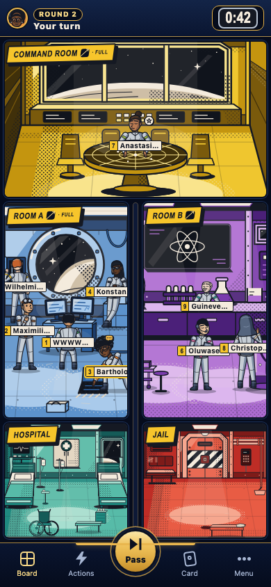
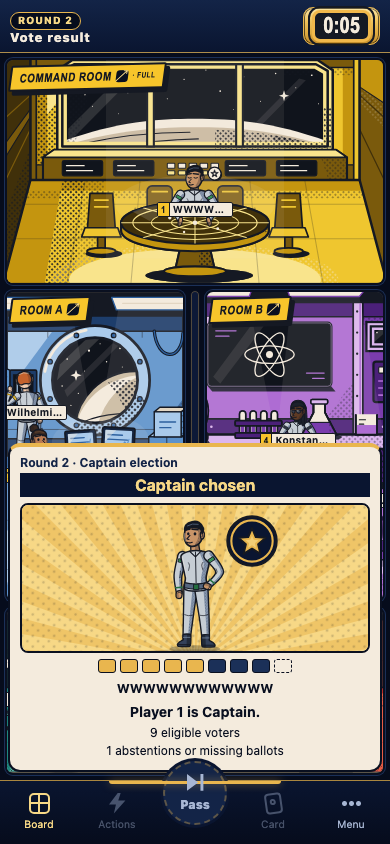
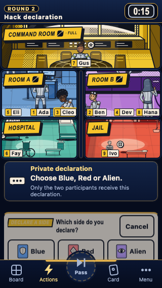
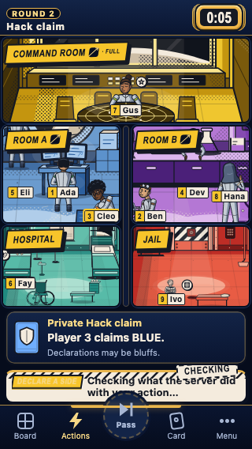

# Claude phone-kit playable-release checkpoint

This continuation adopts the exact two reviewed drawings from Claude PR #127 at `5c9a1510d35d4b9762f9bc2a27dae3f5d53bd5d7`, over the preserved Frontend PR #132 checkpoint `3dbc3699c7589d1031f5e2ca6b163e5cf150a246`. Integration's shared adoption checkpoint is `bbdb95102fdd7b979ec64d4903031042724f8bde`. The canonical hashes and scope are in [claude-phone-kit-provenance.json](claude-phone-kit-provenance.json).

The navy/gold shell has a growing status row, the existing public board, a separate authorized private Hack row, the command strip and five-button navigation with a raised central Pass. On short phones, quiet bands use their existing 30 px row minimum; actual targets retain the unchanged pure character geometry and a measured 44 px minimum. The Code strip keeps the exact prompt and one-use warning, equal board checks, the count dots and an accessible selection sentence, while omitting the repeated portrait gallery and visual picked-name list. Its undo control stays beside the text through partial selection.

Public vote artwork follows all seven explicit outcomes. The figures wear the outfit of their current public location, with the reviewed shoulder star, bars, tie burst or empty chair/cell anchor. Counts are aggregate only: no voter identities or invented No totals. The complete published count list remains in the accessible text path. The result overlay occupies the actual grid area between the header and navigation; enlarged content can scroll natively. Menu retains its current result above the independently scrolling menu content.

The target's declaration offer and three equal side choices remain reachable. Current authorized claims appear on the two participant phones only, alongside command receipt recovery. Blur removes private DOM and entry animations while the document is still visible; focus alone reopens nothing. Explicit reopen draws settled artwork. A lost response retains the four reconciliation identifiers and resolves the original receipt without resending the declaration.

Motion adoption is deliberately bounded: the existing board and command motion controllers remain; fresh observed public results get a phase-relative opacity entry of at most 320 ms, and the same exchange's observed declaration-to-claim transition at most 300 ms. Reduced motion uses 80 ms. Initial, late, reconnected and reopened content is settled; concealment, obsolete feedback, background, disposal and a motion preference change cancel the applicable entry. No animation callback creates content or changes a phase. Prototype controllers, card flips, ribbon/piece/count stagger and exit choreography are excluded from this checkpoint.

Hosted Ready accepts only the exact exported gameplay tuples paired as 1.4/design-0.2.0 and 1.5/design-0.3.0, with all five player bundles loaded. Crossed and unknown pairs are refused. The SDK emulator helper explicitly supports those pairs and its existing no-assets fixtures; it makes no browser-art loading claim.

## Verification

- Build and both TypeScript checks passed with Node 22.21.1/npm 10.9.4. The exact-lock installed dependency trees were reused; local `npm ci` was not repeated.
- Presentation: 204/204. Game frontend: 472/472. This includes exact drawing/style provenance, Ready pairs, phase-relative entry/no-replay and cancellation tests.
- Phone matrix: 108/108, comprising the 72 baseline measurements and 36 partial Code selections. Sizes 320 × 568 and 390 × 844, normal, safe-area and actual 200% text; normal phones require no page or board scrolling. Targets, strip controls, all five navigation buttons and the raised Pass upper edge are measured and hit tested. Enlarged text may scroll inside its surface, with no reported inaccessible target/control or clipped status.
- Visual/lifecycle review: 34/34. All seven explicit vote outcomes at both sizes; Hack offer/choices/result/conversation; blur during entry, OS reduced motion during public/private entry, settled explicit reopen; enlarged result bounds and native touch reach to its final text; uncertain declaration receipt recovery with the same command ID and one send.
- Existing Hack lifecycle: 25/25. Existing vote lifecycle: 22/22, including the fixed server window, reload/stale handling and mandatory Menu result. The final stylesheet was used for the last run.
- Hosted Vite production build and bundled production-exclusion check passed. No fixture/prototype controller enters production. Vite retains its existing large-chunk advisory.

These browser observations use schema-checked synthetic views. They establish local consumer behavior, not Backend acceptance, physical-device acceptance or deployment. Integration owns final stylesheet inventory/fence pinning, full combined verification, the native Frontend emulator run, combined CI, review and deployment. Shared contracts, manifest files, package scripts and fences were not edited by Frontend.

## Evidence

[Measured phone facts](evidence/claude-phone-kit-2026-10-14/phone-fit.json), [visual/privacy/receipt facts](evidence/claude-phone-kit-2026-10-14/visual-lifecycle.json), [Hack lifecycle](evidence/claude-phone-kit-2026-10-14/hack-lifecycle.json), [vote lifecycle](evidence/claude-phone-kit-2026-10-14/vote-lifecycle.json).

The enlarged vote screenshot is captured after native touch scrolling to the final text; its fact record includes both the panel's header/nav bounds and the reached text bounds.

