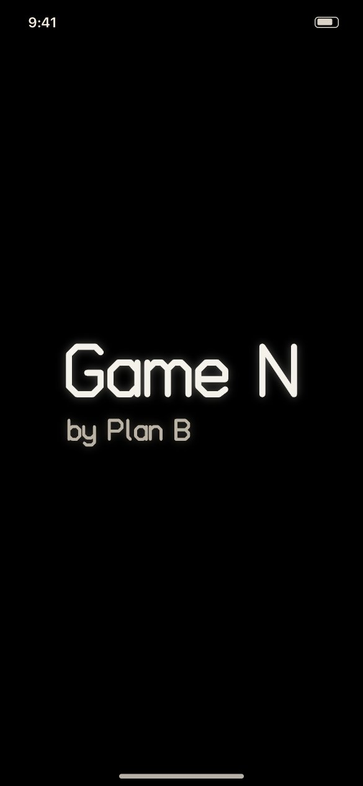

# Two-second app opening

On fresh entry, the game draws white “Game N” and “by Plan B” on black. The browser types the name over 360 ms and the credit from 400 to 760 ms. Both lines stay on screen until the menu opens. The component uses local system text and CSS with no image, video, font download or JavaScript frame loop. Its markup and stylesheet total 1,082 source bytes.

| Phone viewport | During the reveal | Complete label |
| --- | --- | --- |
| 390 × 844 |  |  |
| 430 × 932 |  |  |

Desktop Chromium ran six fresh entries with production headers. At each size we checked full motion, the operating system’s Reduce Motion setting, and Game N’s own Reduce Motion setting. Early and late captures differed during full motion. Each reduced variant showed the complete label throughout. All three variants produced identical settled pixels at the same size. The menu accepted Host after 1,994–2,002 ms. Opening an existing match bypassed the title. The only policy event matched the prior build’s blocked script capability probe. Physical phones and VoiceOver have not been tested. [Observation times and hashes](observations.json) · [Comparison record](compare.json)

| Historical sheet 10 | Playable candidate |
| --- | --- |
|  |  |

Reproduce with the phone harness at `/?scenario=join`. Capture the opening at 0.2 and 1.2 seconds in each motion setting, then tap Host when the menu appears. For the sheet comparison run `node design/tools/phone-ui-native-compare.mjs --only intro --build <phone-build> --out <output>`. The playable source is `1c754ab5`, the clean harness is `548f6c4f`, and the approved artwork baseline is `64e55516`.
