# Food component comparison

The preview column uses Designer’s corrected source at `714edac9`. The native column uses that same source through the Food adapter at `60f7e1b0` in clean local assembly `0aef655b`. The fixture and connected pages used the production response headers. The review harness selects the Designer composition explicitly.

The first four parts use the authorized synthetic fixtures. The reconnecting comparison pairs Designer’s reduced-motion synthetic reference with the native connected run, where the crew, timer and view pose differ. The review covers the reconnecting banner, room rendering and disabled RELEASE.

| Part and viewport | Designer preview | Native component |
| --- | --- | --- |
| `food-panel-03` Panel · RELEASE sending 390 × 844 | <a href="../../../../design/phone-ui/components/food/review/390x844-food-panel-03.jpg">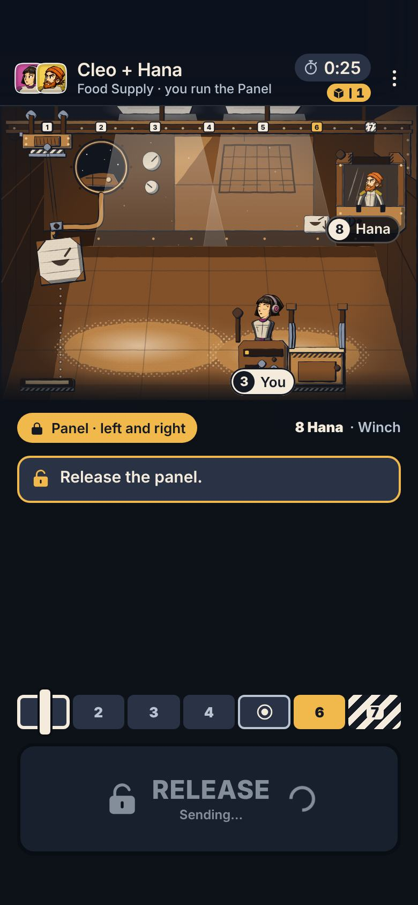</a> | <a href="390x844-panel-release-sending.png">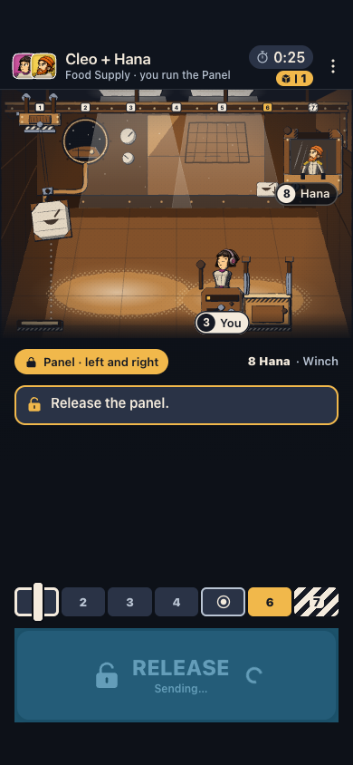</a> |
| `food-panel-03` Panel · RELEASE sending 430 × 932 | <a href="../../../../design/phone-ui/components/food/review/430x932-food-panel-03.jpg">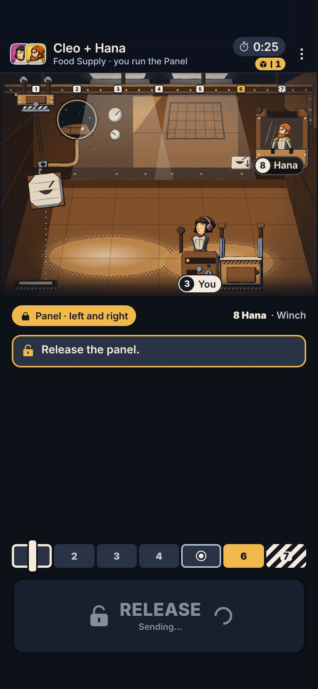</a> | <a href="430x932-panel-release-sending.png">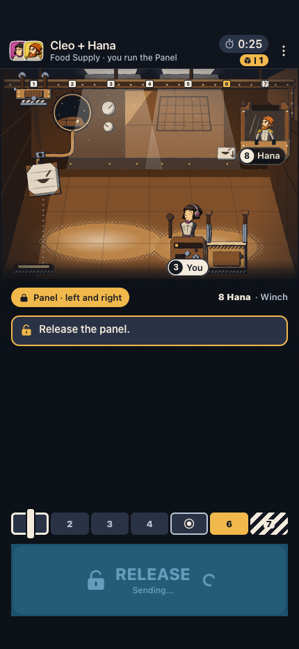</a> |
| `food-panel-04` Panel · LOCK enabled by a fresh view 390 × 844 | <a href="../../../../design/phone-ui/components/food/review/390x844-food-panel-04.jpg">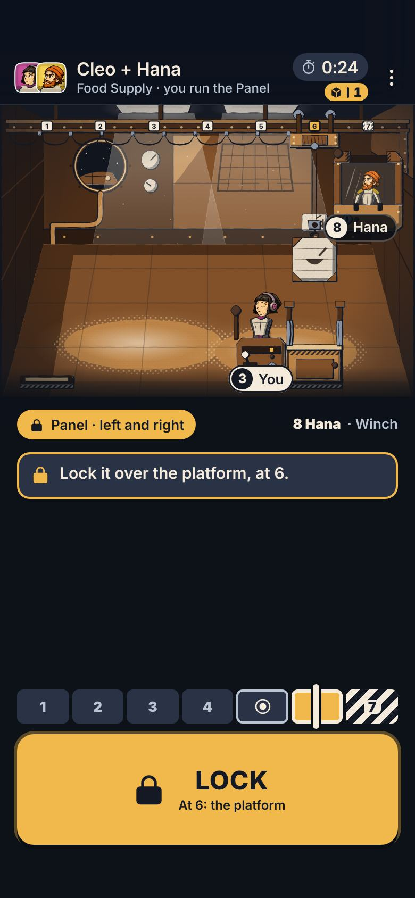</a> | <a href="390x844-panel-lock-from-new-read.png">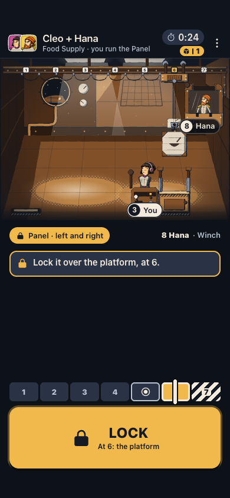</a> |
| `food-panel-04` Panel · LOCK enabled by a fresh view 430 × 932 | <a href="../../../../design/phone-ui/components/food/review/430x932-food-panel-04.jpg">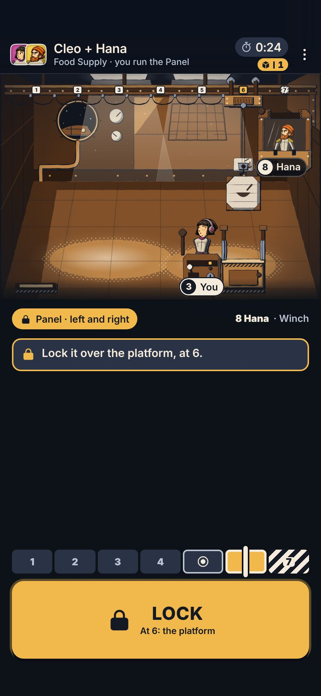</a> | <a href="430x932-panel-lock-from-new-read.png">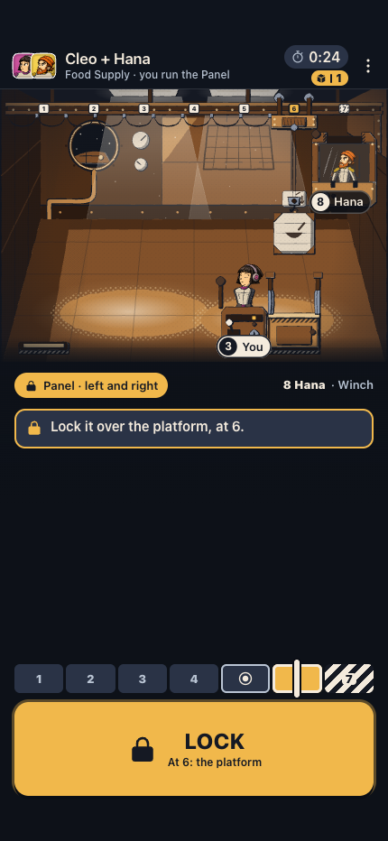</a> |
| `food-winch-03` Winch · original let-go unknown during closure 390 × 844 | <a href="../../../../design/phone-ui/components/food/review/390x844-food-winch-03.jpg">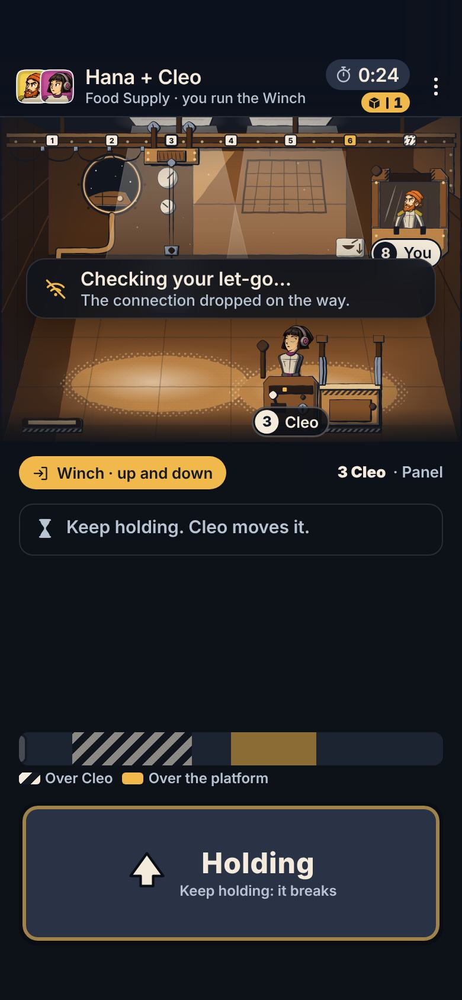</a> | <a href="390x844-winch-recovered-release-sending.png">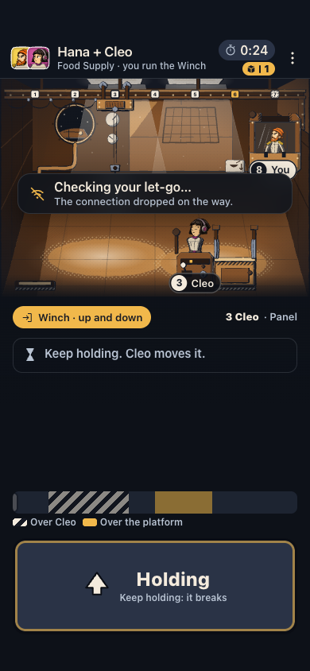</a> |
| `food-winch-03` Winch · original let-go unknown during closure 430 × 932 | <a href="../../../../design/phone-ui/components/food/review/430x932-food-winch-03.jpg">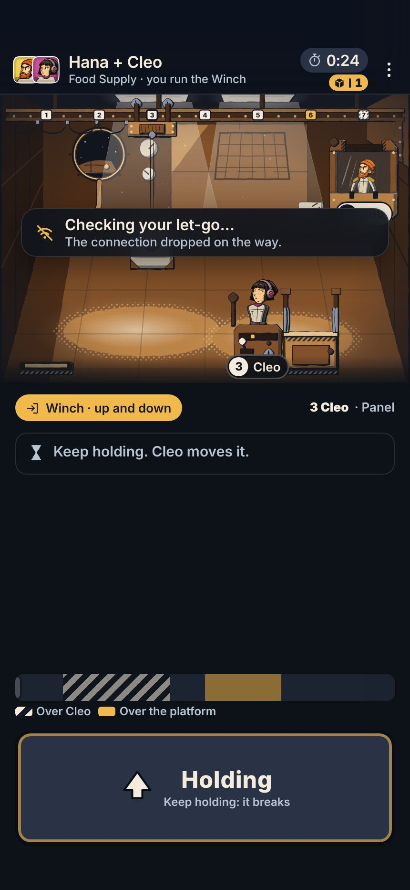</a> | <a href="430x932-winch-recovered-release-sending.png">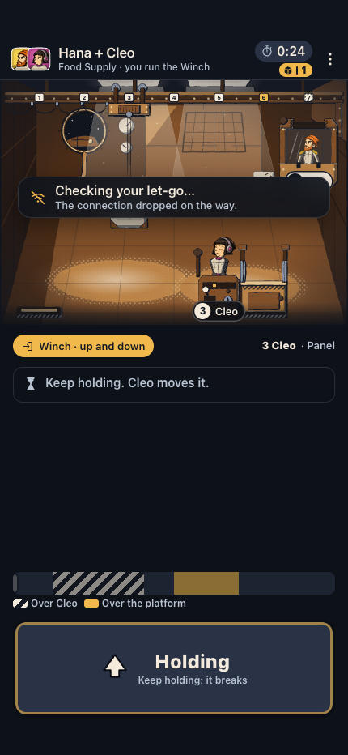</a> |
| `food-winch-12` Winch · authorized landed view enables KEY 390 × 844 |  | <a href="390x844-winch-key-after-closure.png">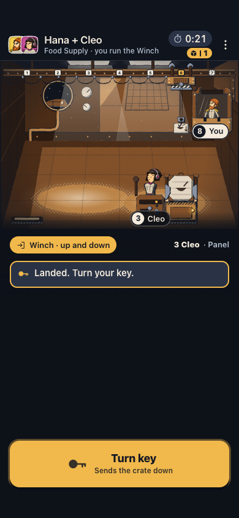</a> |
| `food-winch-12` Winch · authorized landed view enables KEY 430 × 932 | <a href="../../../../design/phone-ui/components/food/review/430x932-food-winch-12.jpg">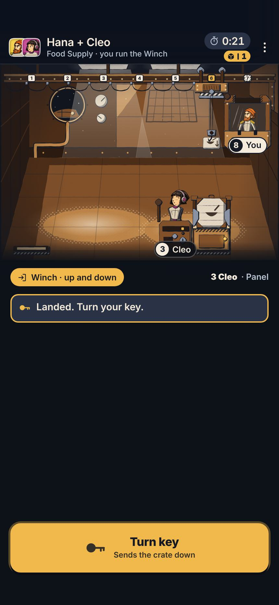</a> | <a href="430x932-winch-key-after-closure.png">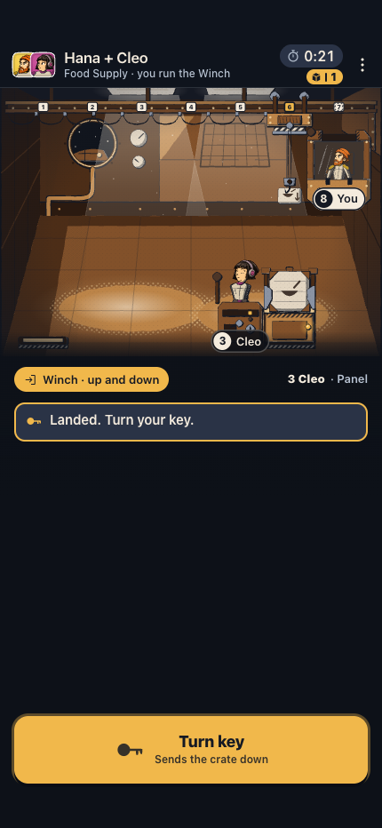</a> |
| `food-panel-18` Panel · reconnecting with RELEASE disabled 390 × 844 | <a href="../../../../design/phone-ui/components/food/review/390x844-food-panel-18-reduced.jpg">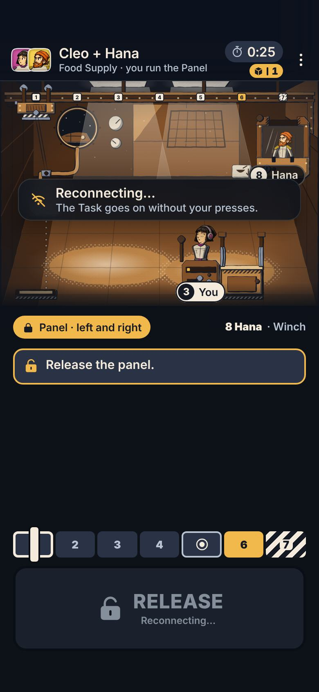</a> | <a href="food-panel-18-watch-silence-390x844.png">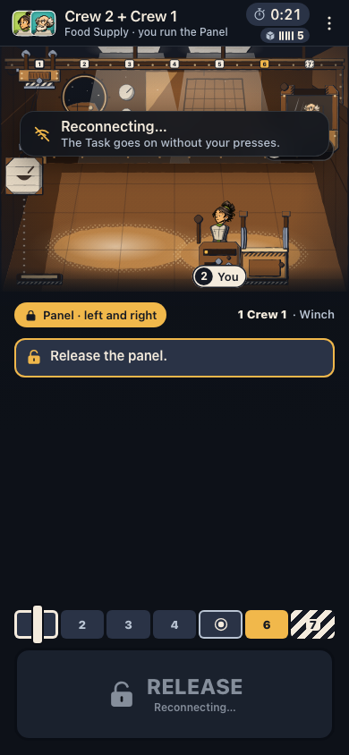</a> |
| `food-panel-18` Panel · reconnecting with RELEASE disabled 430 × 932 | <a href="../../../../design/phone-ui/components/food/review/430x932-food-panel-18-reduced.jpg">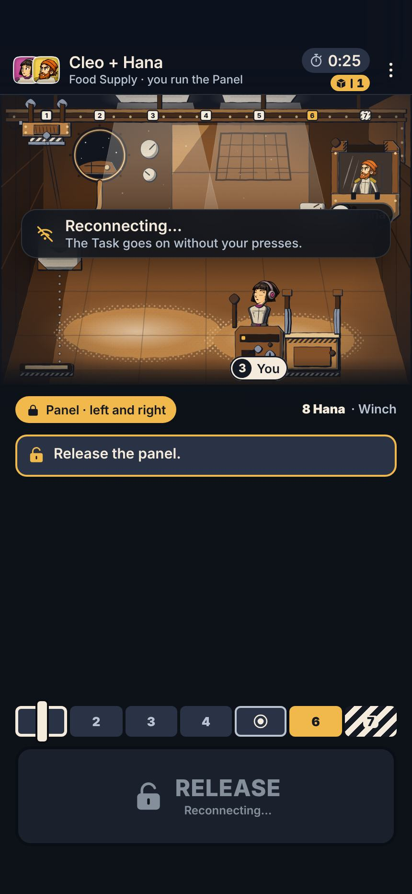</a> | <a href="food-panel-18-watch-silence-430x932.png">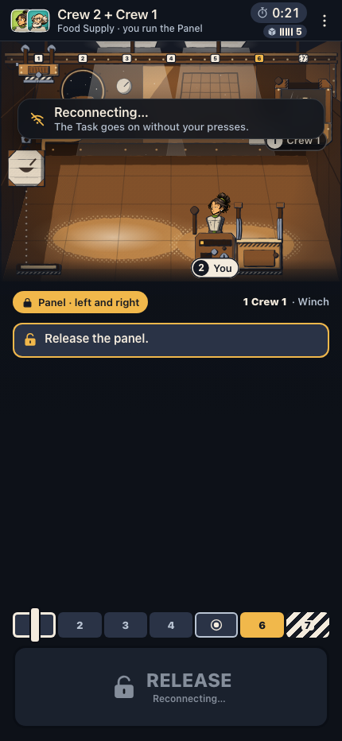</a> |

[Capture manifest](compare.json) · [Lifecycle and provenance](README.md)
