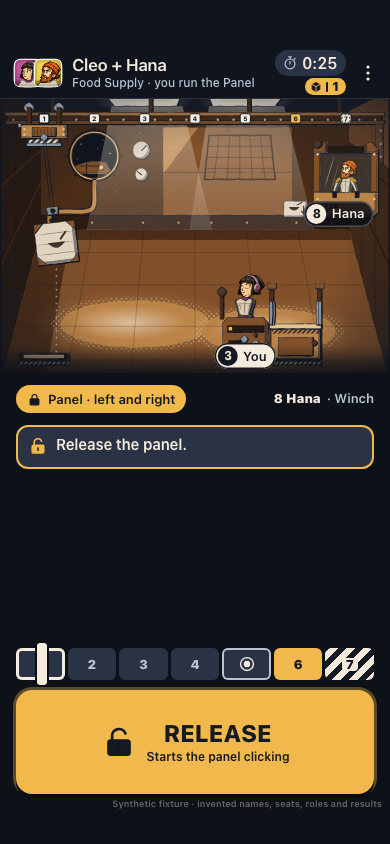
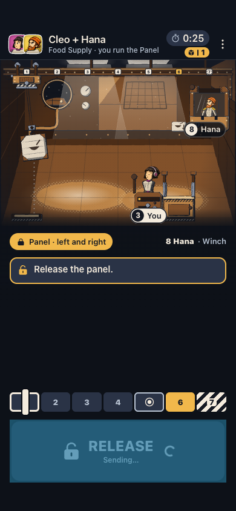
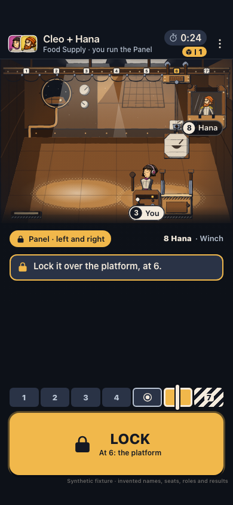
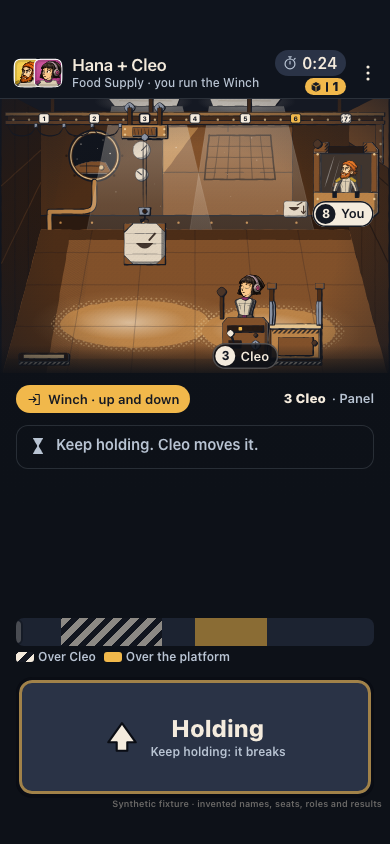
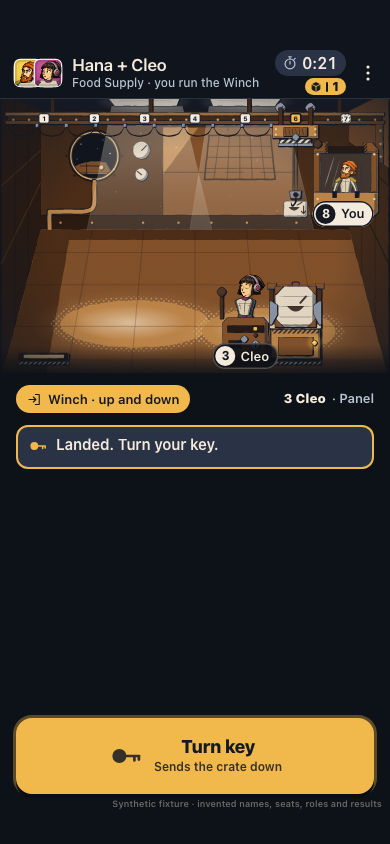
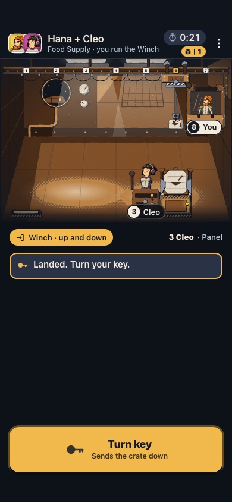
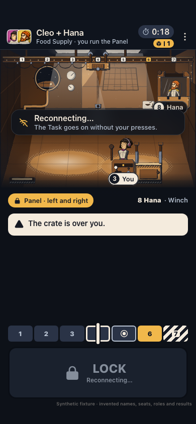
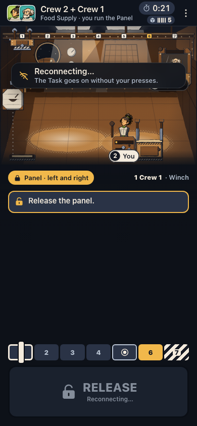
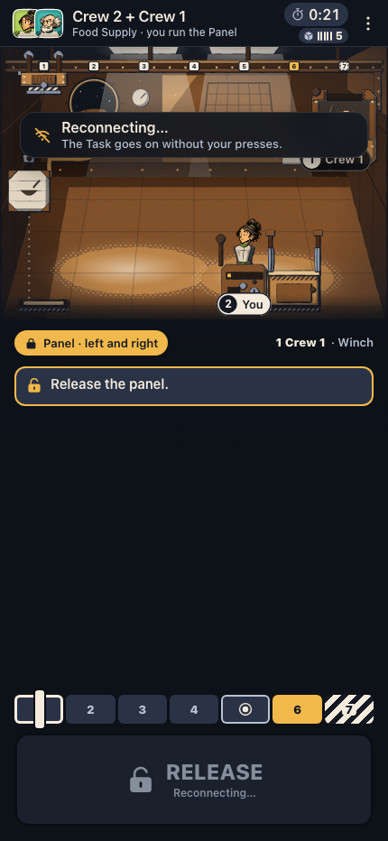

# Supplemental Food side-by-side

This index covers the five Food parts outside the main phone-sheet comparison registry. The canonical thumbnails use the pinned 390 × 844 reference renders. Both native columns use the row’s viewport. Each thumbnail links to its full capture. [Comparison manifest](compare.json)

The first four parts pair the corrected build with the captures accepted in PR #276. The reconnecting part pairs two connected captures from PR #290. The canonical press-state links show the sending and uncertain treatments alongside the base Food states. The fixtures have their own authorized snapshots. [Prior Designer decision](https://github.com/Amirkianfar66/GameN/pull/276#issuecomment-6899774350)

| Part and viewport | Canonical Food reference | Earlier native capture | Native at 68000faa |
| --- | --- | --- | --- |
| `food-panel-03` Panel RELEASE sending 390 × 844 |  [Canonical press state](../food-supply-final-2026-11-13/comparison/food-states-01-390-844-text1-normal-reference.png) |  |  |
| `food-panel-03` Panel RELEASE sending 430 × 932 |  [Canonical press state](../food-supply-final-2026-11-13/comparison/food-states-01-390-844-text1-normal-reference.png) |  |  |
| `food-panel-04` Panel LOCK after a fresh view 390 × 844 |  |  |  |
| `food-panel-04` Panel LOCK after a fresh view 430 × 932 |  |  |  |
| `food-winch-03` Winch awaiting the original release receipt 390 × 844 |  [Canonical press state](../food-supply-final-2026-11-13/comparison/food-states-04-390-844-text1-normal-reference.png) |  |  |
| `food-winch-03` Winch awaiting the original release receipt 430 × 932 |  [Canonical press state](../food-supply-final-2026-11-13/comparison/food-states-04-390-844-text1-normal-reference.png) |  |  |
| `food-winch-12` Winch KEY after verified closure 390 × 844 |  |  |  |
| `food-winch-12` Winch KEY after verified closure 430 × 932 |  |  |  |
| `food-panel-18` Panel reconnecting with RELEASE disabled 390 × 844 |  |  |  |
| `food-panel-18` Panel reconnecting with RELEASE disabled 430 × 932 |  |  |  |

The manifest identifies each canonical page and query, the prior approval, both exact capture reports, and the image digests. Use the capture commands in the evidence notes to regenerate the corrected column. [Reproduction and timing](README.md)
